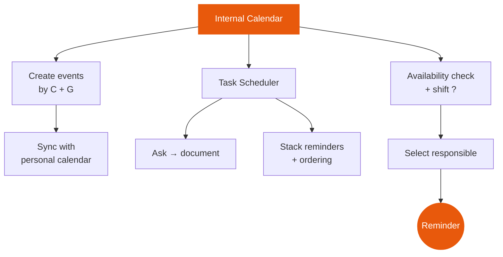

# Feature 1 — Calendar / Scheduling

> `C` = caregiver · `G` = senior

## Scope

- Internal calendar
- Events creatable by **C and G**
- Sync with personal calendar (C's external calendar — provider **open**)
- Actions on scheduled tasks:
  - `Ask` → Document (agent asks G a predefined question, logs answer in Diary)
  - `Stock reminder` → initiate ordering
- Availability check → shift appointment or assign appointment responsible C → reminders for C and G (configurable in calendar)

## Structure

