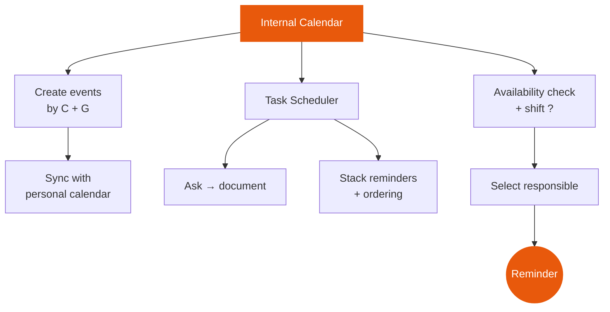
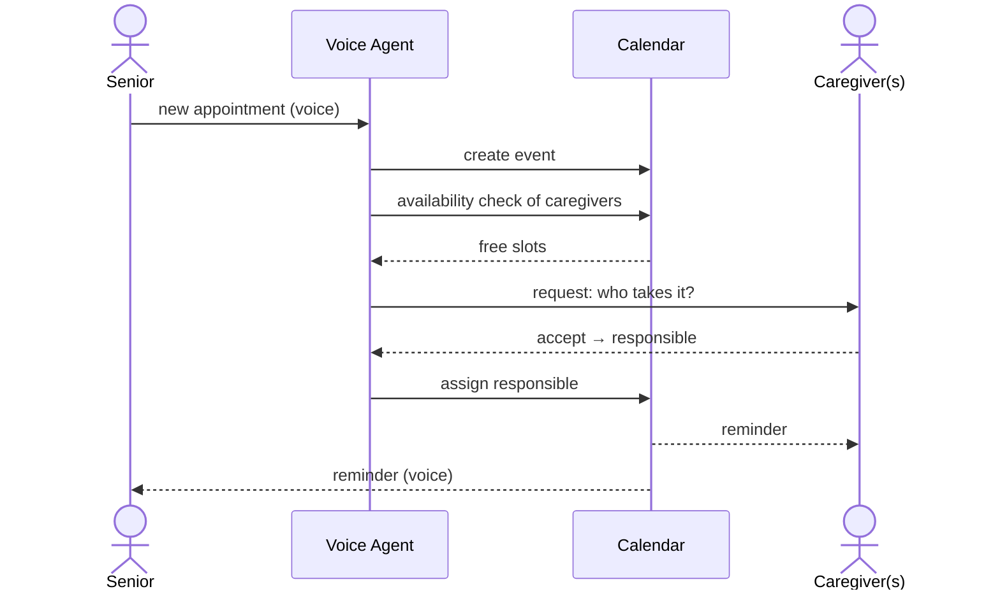

# Feature 1 — Calendar / Scheduling

> Source: `todo/IMG_2834`, `IMG_2835`. Priority: **M** (Primary #4, core ✔).
> `C` = caregiver · `G` = senior

## Scope

- Internal calendar
- Events creatable by **C and G**
- Sync with personal calendar (C's external calendar — provider **open**)
- Task scheduler
  - Ask → document (agent asks G, logs answer)
  - Stack reminders + ordering
- Availability check (+ shift?) → select responsible → reminder

## Structure

## Flow — task needs a responsible caregiver

## Open points

- [ ] "+ shift?" — shift event if nobody available? **to be discussed**
- [ ] "Ask → document": what is asked, where stored (diary?)
- [ ] Ordering logic of stacked reminders
- [ ] Which external calendars to sync
