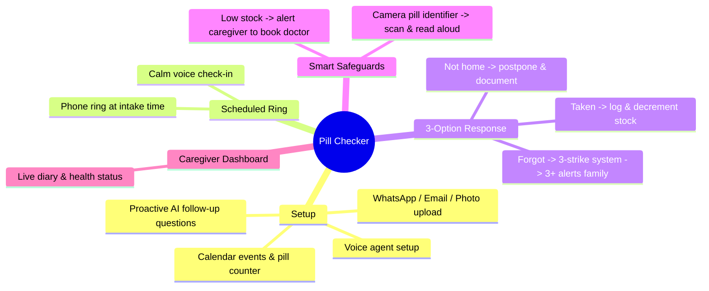
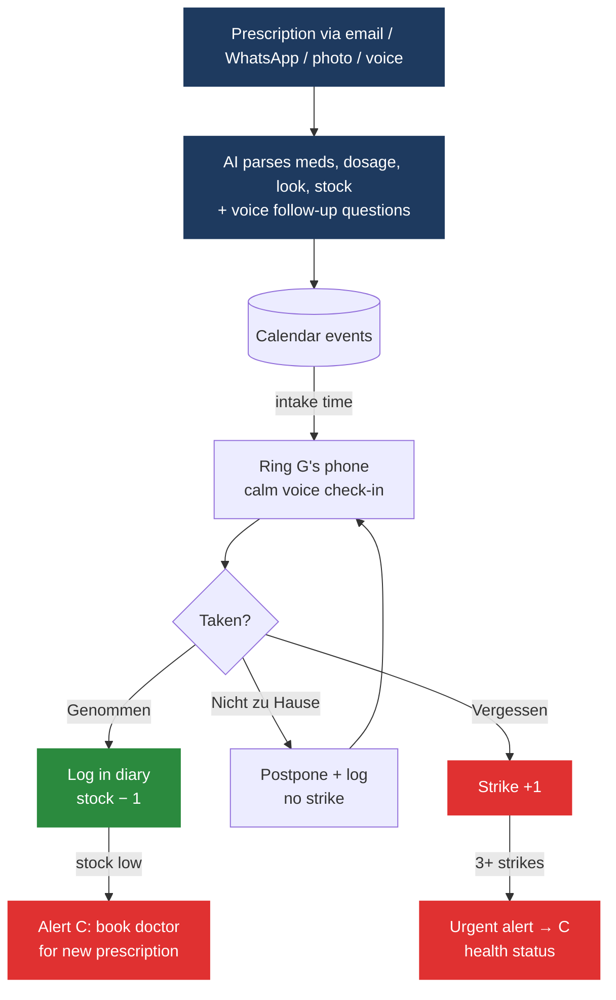

# Feature 2 — Pill Checker

> Source: whiteboard photo IMG_2836 + refined team flow. Priority: **M** (Primary #3, core ✔).

## Scope

- **Prescription Ingestion (Setup):**
  - Doctor sends prescription / *Medikationsplan* via **Email, WhatsApp, or messenger**, OR caregiver uploads a **photo**, OR manual setup via **Voice Agent**.
  - AI parses medicines, dosages, visual appearance, and stock count -> generates **Calendar events** (intake times = events).
- **Proactive Voice Setup (Conversational AI):**
  - When a prescription is uploaded, the voice agent immediately confirms what it sees and asks follow-up setup questions (e.g., *"Do you want me to set up reminders for these? What time works best? How many pills are in the box?"*).
- **Scheduled Reminder Ring:**
  - System rings the senior's phone/device at the scheduled time so it isn't ignored.
  - Agent asks gently in a calm tone whether they have taken the medicine.
- **3-Option Intake Check (Voice OR Tap Buttons):**
  1. **Taken (`Genommen`):** Confirms intake, decrements pill inventory, logs in Caregiver Diary.
  2. **Not Home (`Nicht zu Hause`):** Postpones reminder to a suitable later time + documents in Diary (no strike).
  3. **Forgot / Missed (`Vergessen`):** Increments **Strike Counter (`1/3`, `2/3`)**. At **3+ strikes**, triggers an urgent alert to the family/caregiver + updates Health Status.
- **Low-Stock & Doctor Refill Alert:**
  - Tracks remaining pill count; when medicines are close to running out, alerts the caregiver to **book an appointment with the doctor** for a new prescription.
- **"Forgot Which Medicine" Camera Identifier:**
  - Senior taps **"Forgot which pill / Mix-up"** -> opens camera -> points at the medicine box/blister -> AI identifies the medicine and reads out what it is and how to take it.
- **Full Caregiver Audit Log:**
  - Every ring, response, strike, camera scan, and stock warning is documented in the **Caregiver Diary**.

## Structure

## Flow — daily intake

## Open points

- [ ] Strike counter reset: per day, per medicine, or after C acknowledges? **open / to be discussed**
- [ ] Low-stock threshold (days of supply left?) **open / to be discussed**
- [ ] "Not home" postpone: how much later, and how many times before it counts as a strike? **open / to be discussed**
- [ ] No answer to the ring: treat as `Vergessen`? **open / to be discussed**
- [ ] Pill box w/ sensors = tertiary (C) — out of demo scope?
