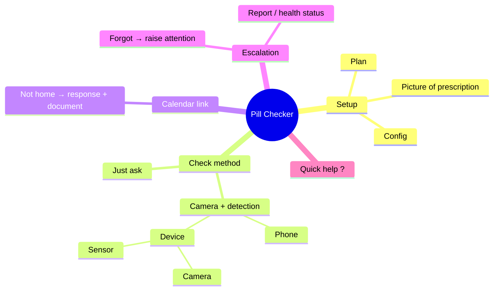
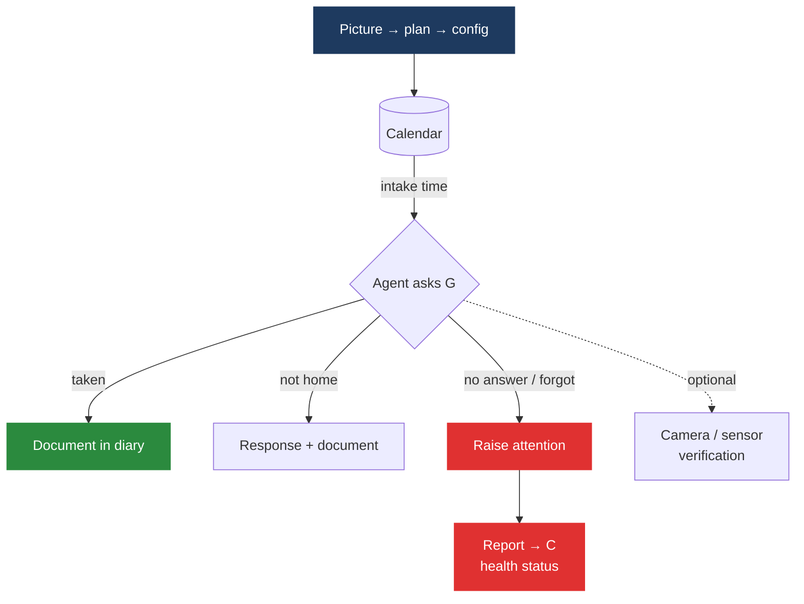

# Feature 2 — Pill Checker

> Source: whiteboard photo IMG_2836 (not in repo). Priority: **M** (Primary #3, core ✔).

## Scope

- Works with **calendar** (intake times = events)
- **Setup:** from picture → plan → config
- **Intake check — how?**
  - Camera + detection → phone or device (camera / sensor)
  - Just ask (voice confirmation)
- **Scheduled agent asks** → document in diary
- **Not home?** → response + document
- **Forgot?** → raise attention → report (health status)
- **Quick help** (content **open**)

## Structure

## Flow — daily intake

## Open points

- [ ] Verification method for demo: camera vs. "just ask"
- [ ] "Quick help" — what exactly?
- [ ] Escalation thresholds (retries, delay before alert)
- [ ] "Not home" — how detected (location? answer?)
- [ ] Pill box w/ sensors = tertiary (C) — out of demo scope?
