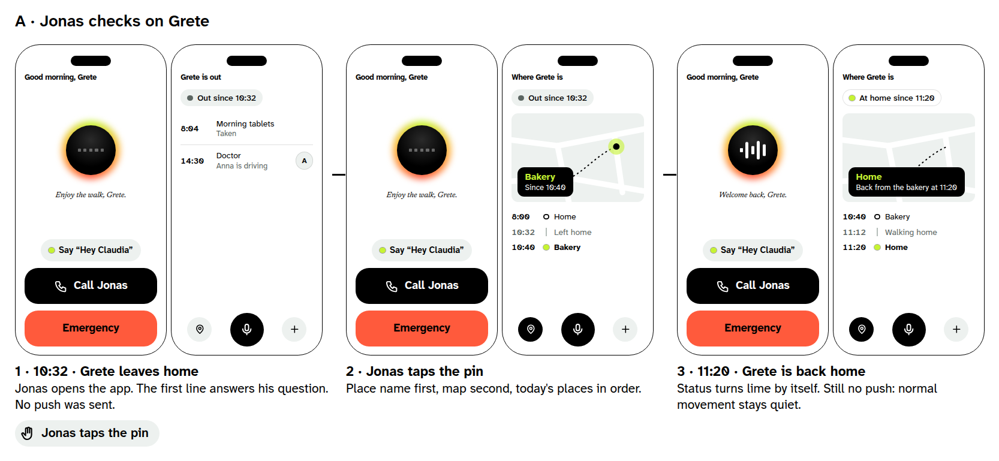
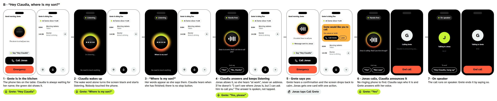
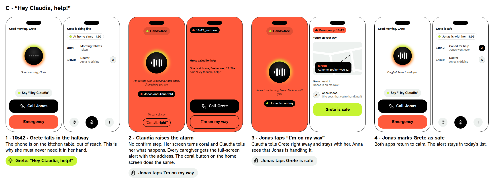
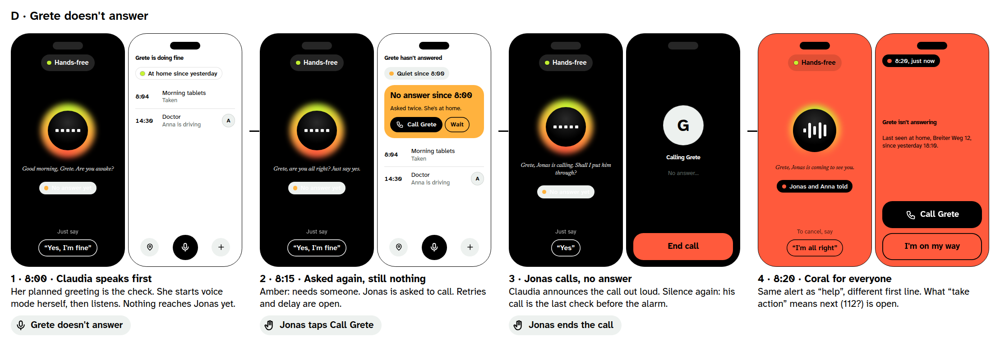
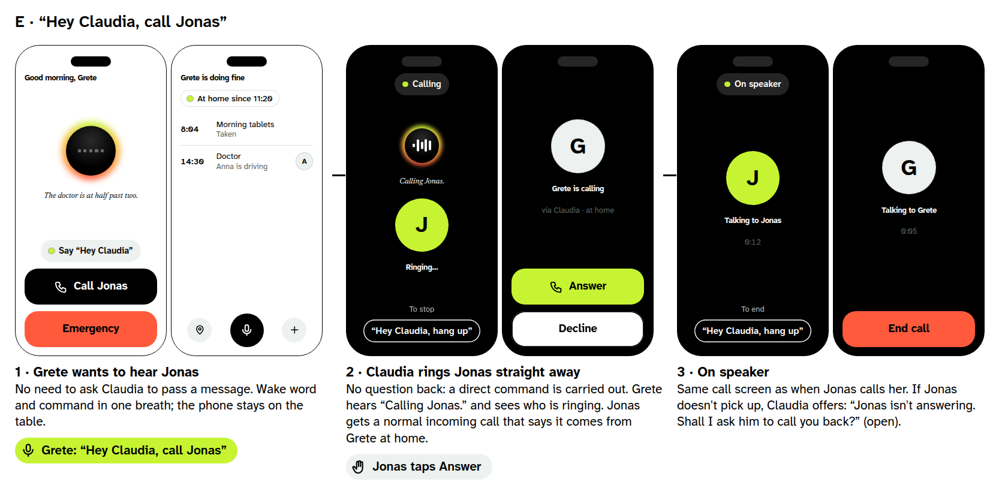

# Feature 3 — Live Location + Emergency Alert

> Source: whiteboard `IMG_2837`. Priority: **M** (Primary #6 + #9; core cluster incl. messaging).
> `C` = caregiver · `G` = senior. Names (Grete, Jonas, Anna) and places are examples, as in [`design.html`](../design.html).
> Interactive mockup: [`03-live-location.html`](03-live-location.html) · Storyboard images: [`03-live-location/`](03-live-location/)

## 1. Features and explanation

**Pain point:** C cannot be with G all day. Not knowing whether G is safe is the constant background worry. Calling to check feels like control and costs both of them energy.

**Idea:** Claudia answers *"is she all right?"* before C has to ask, and turns *"something is wrong"* into one clear call to action.

| # | Feature | Who | What it does | Board priority |
|---|---|---|---|---|
| 0 | **Hands-free** | G | Wake word **"Hey Claudia"** starts every conversation. After that G only talks: no tap to start, answer or end | Applies to all |
| 1 | **C sees G** | C | G's location as a plain place name ("At home"), a map, and today's places in order | Core |
| 2 | **G sees C** | G | "Where is my son?" → coarse answer ("Jonas is at work"), never an address | In brackets → **open** |
| 2b | **Call Jonas (direct)** | G → C | "Hey Claudia, call Jonas" rings Jonas at once, no question back; same as the *Call Jonas* button | Core cluster (messaging) |
| 2a | **Call request** | G → C | "Ask him to call me" → push to C; Claudia announces his call back, G answers by saying "yes" | Core cluster (messaging) |
| 3 | **Emergency alert** | G → all C | "Hey Claudia, help!", the Emergency button, or no answer → full-screen alert on C with G's location | Core |

### Hands-free rules (senior app)

| Rule | Why |
|---|---|
| Claudia always listens for "Hey Claudia"; a green dot on the home screen shows it | G may be across the room, or on the floor after a fall |
| Wake word alone opens voice mode (black screen); no touch needed | The phone can stay on the table |
| Claudia detects the end of speech; no stop button | Nothing to find or press |
| Every question Claudia asks is answered by voice; the screen shows the words to say ("Yes", "No, thanks") | Screen is a hint, never a step |
| Incoming calls are announced and accepted by voice, then run on speaker | No ringing phone to find |
| Call Jonas and Emergency buttons stay on the idle home screen as fallback only | Design principle: "Buttons for what can't wait" |

### Emergency triggers

| Trigger | Demo | Note |
|---|---|---|
| "Hey Claudia, help!" | **Yes** | Primary: works when G can't reach the phone |
| Emergency button | **Yes** | Fallback, same place on every idle senior screen |
| Not responding | **Yes** | Claudia's planned prompt (greeting, tablet check) gets no answer → escalate |
| Smart watch | No | Smart watch = Could (tertiary) |

### Who sees what

| Data | G | C (Jonas) | C (Anna) |
|---|---|---|---|
| G's location | — | Map + place + history | Map + place + history |
| C's location | Coarse place only, if C allows | — | — |
| Emergency alert | Spoken confirmation | Full-screen alert | Full-screen alert |
| Call request | Spoken confirmation | Notification | — (only the asked person) |

## 2. Flows

Each storyboard shows Grete's phone (left) and Jonas's phone (right) per step. Under each step: what moves the story on — 🟢 **Grete speaks** or ✋ **Jonas taps**.

### Overview

| Flow | Started by | Grete does | Jonas does | Ends with |
|---|---|---|---|---|
| A · Jonas checks on Grete | Jonas opens app | nothing | taps pin | status lime, no push |
| B · "Where is my son?" | Grete: "Hey Claudia" | talks only | taps *Call Grete* | call on speaker |
| C · "Help!" | Grete: "Hey Claudia, help!" | talks only | taps *I'm on my way*, *Grete is safe* | both calm |
| D · No answer | Claudia's planned greeting | silent | taps *Call Grete* | coral alert to all |
| E · "Call Jonas" | Grete: "Hey Claudia, call Jonas" | talks only | taps *Answer* | call on speaker |

### Flow A — Jonas checks on Grete

| # | Event | Grete sees / hears | Jonas sees | Next |
|---|---|---|---|---|
| 1 | 10:32 Grete leaves home | home screen | "Grete is out" · *Out since 10:32* | ✋ taps pin |
| 2 | — | — | map, *Bakery since 10:40*, places list | waits |
| 3 | 11:20 Grete back home | *"Welcome back, Grete."* | *At home since 11:20* (lime), no push | — |

### Flow B — "Hey Claudia, where is my son?"

| # | Event | Grete sees / hears | Jonas sees | Next |
|---|---|---|---|---|
| 1 | Grete in the kitchen, phone on table | home · *Say "Hey Claudia"* | normal | 🟢 "Hey Claudia" |
| 2 | Wake word | black voice mode · *I'm listening…* | normal | 🟢 "Where is my son?" |
| 3 | — | her words appear live | normal | auto (end of speech) |
| 4 | Claudia answers | *"Jonas is at work. Shall I ask him to call you?"* · say "Yes" / "No, thanks" | normal | 🟢 "Yes, please" |
| 5 | Request sent | *"I've asked Jonas to call you."* | amber card *Grete would like you to call* | ✋ taps Call Grete |
| 6 | Call comes in | *"Jonas is calling. Shall I put him through?"* | *Claudia is announcing you…* | 🟢 "Yes" |
| 7 | On speaker | *Talking to Jonas* · say "Hey Claudia, hang up" | *Talking to Grete* | — |

If Jonas does not share his location: *"I can't see where Jonas is, but I can ask him to call you."*

### Flow C — "Hey Claudia, help!"

| # | Event | Grete sees / hears | Jonas sees | Next |
|---|---|---|---|---|
| 1 | 10:42 Grete falls, phone out of reach | home | normal | 🟢 "Hey Claudia, help!" |
| 2 | Alarm, no confirm step | coral · *"I'm getting help. Jonas and Anna know."* · say "I'm all right" to cancel | coral alert, address, *Call Grete* / *I'm on my way* | ✋ I'm on my way |
| 3 | Jonas on the way | *"Jonas is on his way, Grete. I'm here with you."* | map, *Anna knows* | ✋ Grete is safe |
| 4 | Resolved | *"I'm glad Jonas is with you."* | *Grete is safe*, event in today's list | — |

### Flow D — Grete doesn't answer

| # | Event | Grete sees / hears | Jonas sees | Next |
|---|---|---|---|---|
| 1 | 8:00 planned greeting | Claudia opens voice mode herself · *"Are you awake?"* | normal | silence |
| 2 | 8:15 asked again | *"Grete, are you all right? Just say yes."* | amber card *No answer since 8:00* | ✋ Call Grete |
| 3 | Jonas calls | *"Jonas is calling. Shall I put him through?"* | *No answer…* | ✋ End call |
| 4 | 8:20 escalation | coral · *"Jonas is coming to see you."* | coral alert *Grete isn't answering* + last place | — |

Any spoken answer at steps 1–3 returns everything to normal.

### Flow E — "Hey Claudia, call Jonas"

| # | Event | Grete sees / hears | Jonas sees | Next |
|---|---|---|---|---|
| 1 | Grete wants to talk to Jonas | home · *Say "Hey Claudia"* | normal | 🟢 "Hey Claudia, call Jonas" |
| 2 | Claudia rings at once, no confirm | *"Calling Jonas."* · *Ringing…* · say "Hey Claudia, hang up" to stop | incoming call *Grete is calling* · *Answer* / *Decline* | ✋ Answer |
| 3 | On speaker | *Talking to Jonas* (same screen as flow B) | *Talking to Grete* | — |

Difference to flow B: B asks Jonas to call back (he may be busy); E calls him now. If Jonas doesn't pick up: *"Jonas isn't answering. Shall I ask him to call you back?"* → continues as flow B step 5 (**open**).

### Screen map

| Role | Screen | Reached by | Changes on |
|---|---|---|---|
| G | Home (idle, wake word on) | default | — |
| G | Voice mode: listening / speaking (black) | "Hey Claudia" or Claudia speaks first | voice only |
| G | Emergency (coral, voice) | "help", button, or escalation | C taps *I'm on my way* → spoken update |
| G | Calling (outgoing, voice) | "Hey Claudia, call Jonas" or *Call Jonas* button | Jonas answers → on speaker |
| G | On speaker call | "Yes" to announced call, or Jonas answers | "Hey Claudia, hang up" |
| C | Incoming call from Grete | Grete calls | taps *Answer* |
| C | Today (status line) | app open | G leaves / arrives → tag text + colour |
| C | Location (map + places) | pin tab | G moves |
| C | Call request card | push | G asks |
| C | Alert (coral) | push, full screen | emergency / no response |
| C | Dashboard: Where Grete is + sharing | web, pin in rail | G moves; switches |

## 3. Design mockup

[`03-live-location.html`](03-live-location.html): pick a flow, then press the green **Grete says** line to "speak" for her, or the highlighted button on Jonas's phone. Also contains all screens in one view and the dashboard location page.

## Open points

- [ ] G sees C: in brackets on board → in demo or not?
- [ ] "Take action" after alert: who is called, in which order; call emergency services (112)? Shown as example only
- [ ] Not responding: retries, delays, which prompts count
- [ ] G cancels emergency by voice ("I'm all right"): allowed? within what time?
- [ ] Always-on wake word: battery, privacy, false triggers; ElevenLabs support for wake word in demo?
- [ ] Auto-answer calls on speaker vs. ask first
- [ ] Direct call not answered: offer call request (flow B) automatically? voicemail?
- [ ] Notify C when G leaves home? (mockup: off by default, dashboard switch)
- [ ] Known places: who sets them (C in dashboard?)
- [ ] Location source: phone GPS only for demo?
- [ ] Privacy / consent for both directions; data retention of history
- [ ] Messaging part of this cluster: scope beyond call request undefined
- [ ] Smart watch trigger (tertiary) out of demo scope?
