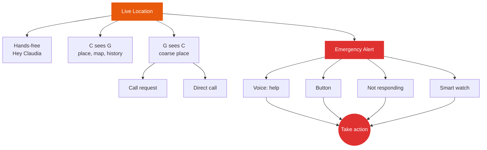

# Feature 3 — Live Location + Emergency Alert

> `C` = caregiver · `G` = senior

## Scope

- **Hands-free:** wake word "Hey Claudia" starts every conversation; after that `G` only talks
- **C sees G:** place name, map, today's places; normal movement sends no push
- **G sees C** (lower priority, consent **open**):
  - "Where is my son?" → coarse answer ("at work")
  - "Ask him to call me" → call request to `C`
  - "Call Jonas" → direct call, no question back
- **Emergency alert** → full-screen alert to every `C`, with location
  - "Hey Claudia, help!"
  - Button (fallback)
  - Not responding → amber, then coral
  - Smart watch (Could)
- "Take action" after an alert → **open**

## Structure

Spec, requirements and flows: [`specs/03-live-location/spec.md`](../specs/03-live-location/spec.md)
