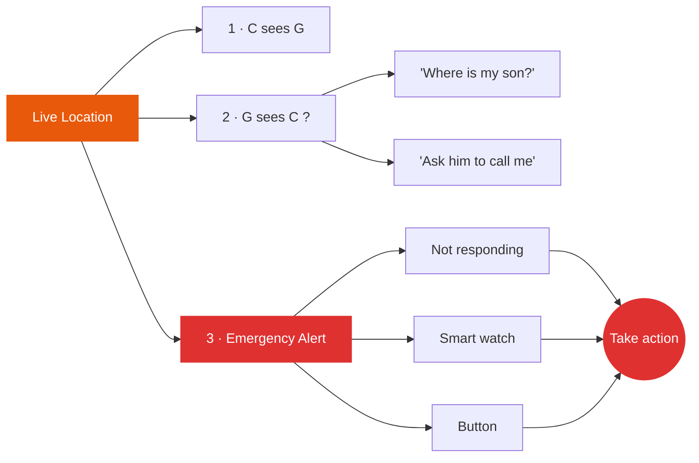
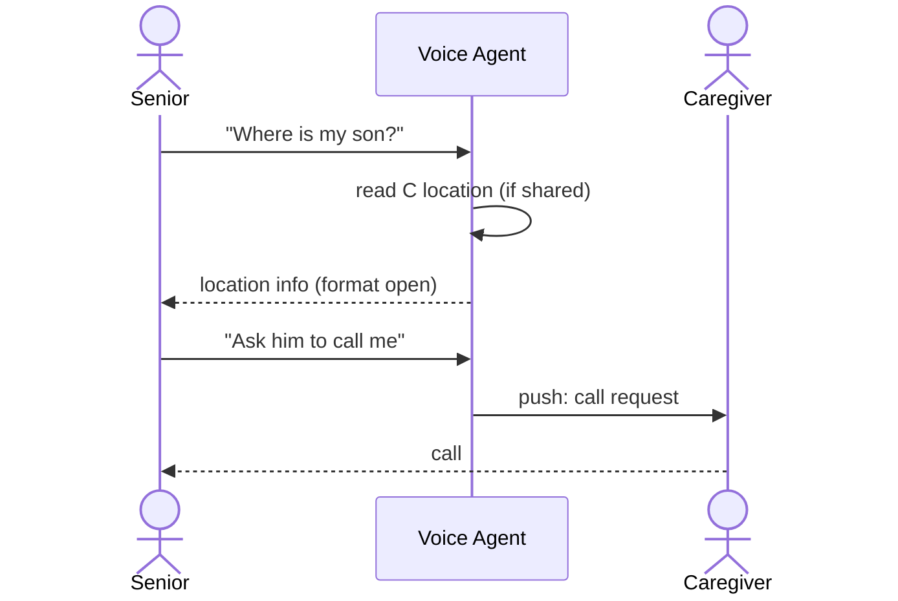

# Feature 3 — Live Location + Emergency Alert

> Source: `todo/IMG_2837`. Priority: **M** (Primary #6 + #9; core cluster incl. messaging).

## Scope

1. **C sees G** — caregiver sees senior's location
2. **(G sees C)** — in brackets on board → lower priority / **open**
   - "Where is my son?"
   - "Ask him to call me"
3. **Emergency alert** — triggers:
   - Not responding → take action
   - Smart watch
   - Button

## Structure

## Flow — "Where is my son?"

## Open points

- [ ] "Take action" — what action? (call C, call emergency services, escalation chain)
- [ ] Privacy / consent for G sees C
- [ ] Smart watch = tertiary (C) — demo with button only?
- [ ] Messaging part of this cluster — scope undefined
