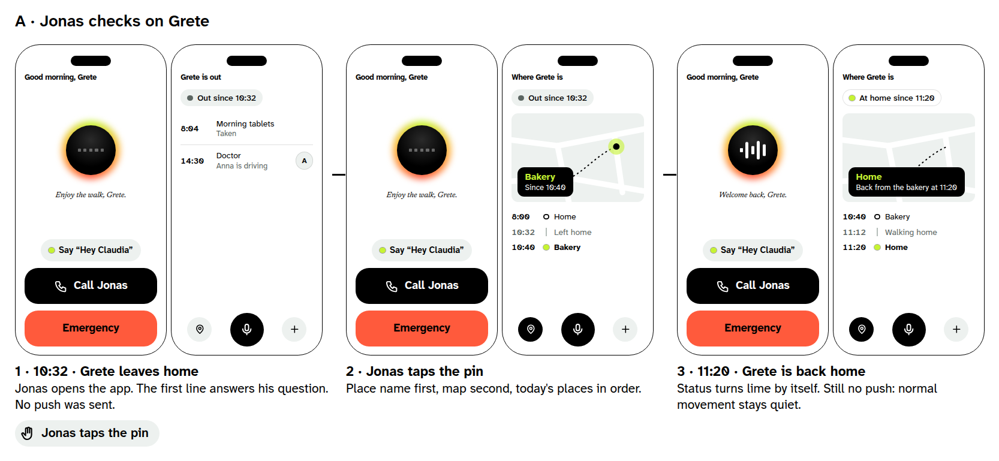
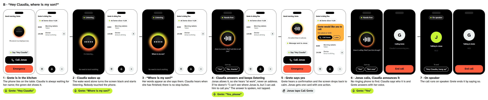
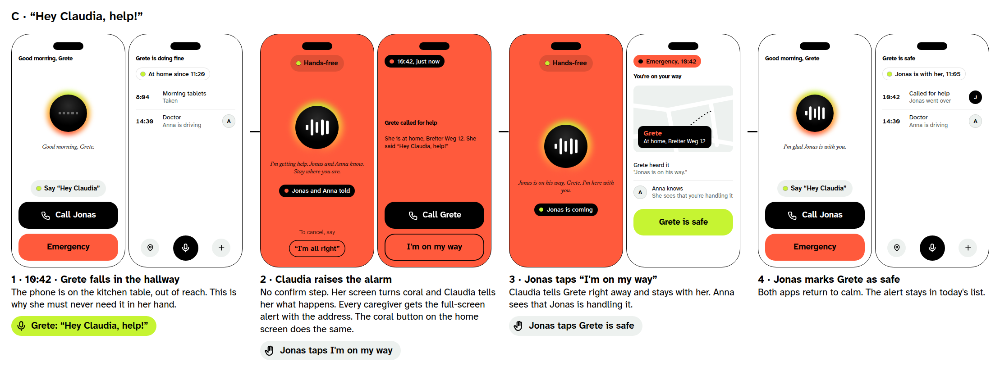
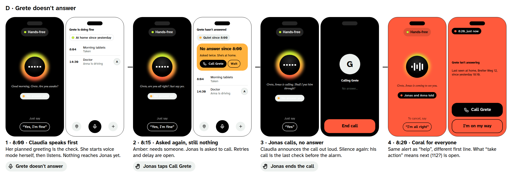
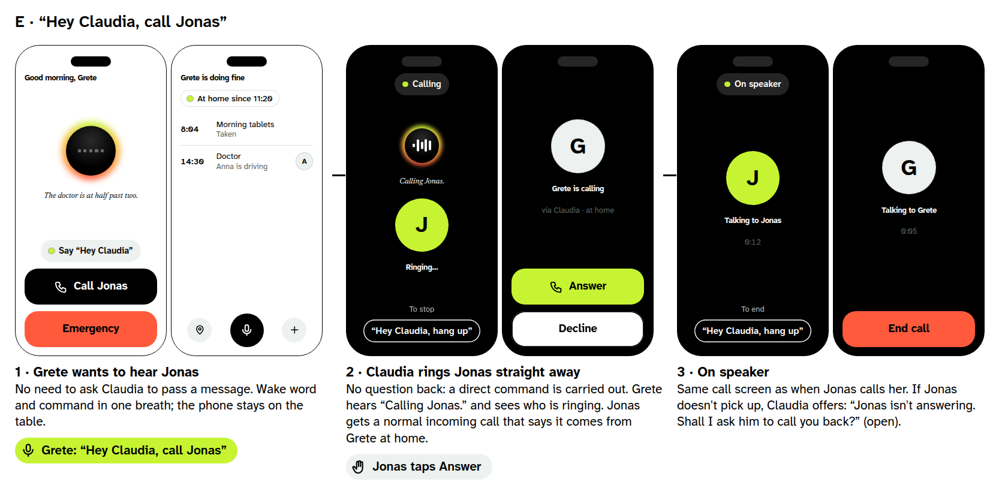

# Feature 3 — Live Location + Emergency Alert · Flows

> Part of [Feature 3](../03-live-location.md) · Previous: [Features](features.md) · Mockup: [`mockup.html`](mockup.html)
> Names (Grete, Jonas, Anna), places and times are examples.

Each storyboard shows Grete's phone (left) and Jonas's phone (right) per step. Under each step: what moves the story on — 🟢 **Grete speaks** or ✋ **Jonas taps**. Images are exported from [`mockup.html`](mockup.html) (`mockup.html?export=a` … `?export=e`).

## Overview

| Flow | Started by | Grete does | Jonas does | Ends with | Spec ID |
|---|---|---|---|---|---|
| A · Jonas checks on Grete | Jonas opens app | nothing | taps pin | status lime, no push | LOC-1 |
| B · "Where is my son?" | Grete: "Hey Claudia" | talks only | taps *Call Grete* | call on speaker | LOC-2, LOC-3 |
| C · "Help!" | Grete: "Hey Claudia, help!" | talks only | taps *I'm on my way*, *Grete is safe* | both calm | EMG-1, EMG-4, EMG-5 |
| D · No answer | Claudia's planned greeting | silent | taps *Call Grete* | coral alert to all | EMG-2 |
| E · "Call Jonas" | Grete: "Hey Claudia, call Jonas" | talks only | taps *Answer* | call on speaker | LOC-4 |

## Flow A — Jonas checks on Grete

| # | Event | Grete sees / hears | Jonas sees | Next |
|---|---|---|---|---|
| 1 | 10:32 Grete leaves home | home screen | "Grete is out" · *Out since 10:32* | ✋ taps pin |
| 2 | — | — | map, *Bakery since 10:40*, places list | waits |
| 3 | 11:20 Grete back home | *"Welcome back, Grete."* | *At home since 11:20* (lime), no push | — |

## Flow B — "Hey Claudia, where is my son?"

| # | Event | Grete sees / hears | Jonas sees | Next |
|---|---|---|---|---|
| 1 | Grete in the kitchen, phone on table | home · *Say "Hey Claudia"* | normal | 🟢 "Hey Claudia" |
| 2 | Wake word | black voice mode · *I'm listening…* | normal | 🟢 "Where is my son?" |
| 3 | — | her words appear live | normal | auto (end of speech) |
| 4 | Claudia answers | *"Jonas is at work. Shall I ask him to call you?"* · say "Yes" / "No, thanks" | normal | 🟢 "Yes, please" |
| 5 | Request sent | *"I've asked Jonas to call you."* | amber card *Grete would like you to call* | ✋ taps Call Grete |
| 6 | Call comes in | *"Jonas is calling. Shall I put him through?"* | *Claudia is announcing you…* | 🟢 "Yes" |
| 7 | On speaker | *Talking to Jonas* · say "Hey Claudia, hang up" | *Talking to Grete* | — |

If Jonas does not share his location: *"I can't see where Jonas is, but I can ask him to call you."*

## Flow C — "Hey Claudia, help!"

| # | Event | Grete sees / hears | Jonas sees | Next |
|---|---|---|---|---|
| 1 | 10:42 Grete falls, phone out of reach | home | normal | 🟢 "Hey Claudia, help!" |
| 2 | Alarm, no confirm step | coral · *"I'm getting help. Jonas and Anna know."* · say "I'm all right" to cancel | coral alert, address, *Call Grete* / *I'm on my way* | ✋ I'm on my way |
| 3 | Jonas on the way | *"Jonas is on his way, Grete. I'm here with you."* | map, *Anna knows* | ✋ Grete is safe |
| 4 | Resolved | *"I'm glad Jonas is with you."* | *Grete is safe*, event in today's list | — |

The Emergency button on the home screen starts the same flow at step 2.

## Flow D — Grete doesn't answer

| # | Event | Grete sees / hears | Jonas sees | Next |
|---|---|---|---|---|
| 1 | 8:00 planned greeting | Claudia opens voice mode herself · *"Are you awake?"* | normal | silence |
| 2 | 8:15 asked again | *"Grete, are you all right? Just say yes."* | amber card *No answer since 8:00* | ✋ Call Grete |
| 3 | Jonas calls | *"Jonas is calling. Shall I put him through?"* | *No answer…* | ✋ End call |
| 4 | 8:20 escalation | coral · *"Jonas is coming to see you."* | coral alert *Grete isn't answering* + last place | — |

Any spoken answer at steps 1–3 returns everything to normal. Retries and delays are **open**.

## Flow E — "Hey Claudia, call Jonas"

| # | Event | Grete sees / hears | Jonas sees | Next |
|---|---|---|---|---|
| 1 | Grete wants to talk to Jonas | home · *Say "Hey Claudia"* | normal | 🟢 "Hey Claudia, call Jonas" |
| 2 | Claudia rings at once, no confirm | *"Calling Jonas."* · *Ringing…* · say "Hey Claudia, hang up" to stop | incoming call *Grete is calling* · *Answer* / *Decline* | ✋ Answer |
| 3 | On speaker | *Talking to Jonas* (same screen as flow B) | *Talking to Grete* | — |

Difference to flow B: B asks Jonas to call back (he may be busy); E calls him now. If Jonas doesn't pick up: *"Jonas isn't answering. Shall I ask him to call you back?"* → continues as flow B step 5 (**open**).

## Screen map

| Role | Screen | Reached by | Changes on |
|---|---|---|---|
| G | Home (idle, wake word on) | default | — |
| G | Voice mode: listening / speaking (black) | "Hey Claudia" or Claudia speaks first | voice only |
| G | Emergency (coral, voice) | "help", button, or escalation | C taps *I'm on my way* → spoken update |
| G | Calling (outgoing, voice) | "Hey Claudia, call Jonas" or *Call Jonas* button | Jonas answers → on speaker |
| G | On speaker call | "Yes" to announced call, or Jonas answers | "Hey Claudia, hang up" |
| C | Today (status line) | app open | G leaves / arrives → tag text + colour |
| C | Location (map + places) | pin tab | G moves |
| C | Call request card | push | G asks |
| C | Incoming call from Grete | Grete calls | taps *Answer* |
| C | Alert (coral) | push, full screen | emergency / no response |
| C | Dashboard: Where Grete is + sharing | web, pin in rail | G moves; switches |
