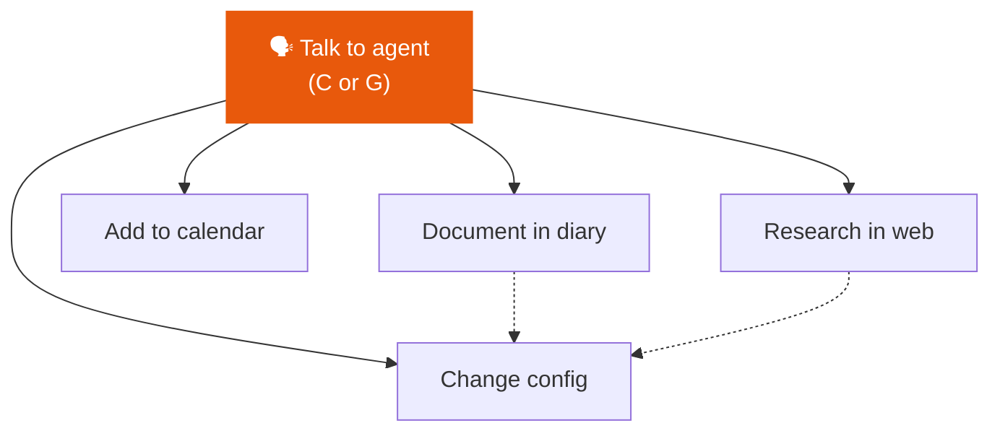
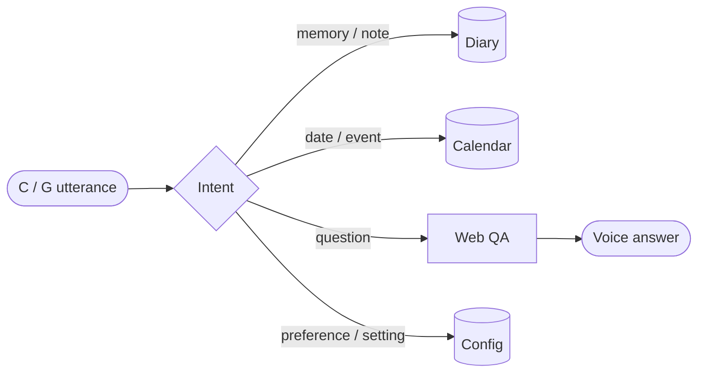

# Feature 4 — QA / Setup

> Source: whiteboard photo IMG_2838 (not in repo). Priority: **M** (Primary #7 Web QA + #8 Setup, core cluster).
> Who: **C and G** both use it.

## Scope

- Entry: **talk to agent**
- Outcomes:
  - Document in diary
  - Add to calendar
  - Research in web
  - Change config

## Structure

## Intent routing

## Open points

- [ ] Arrows diary/web → change config on board: meaning **to be discussed**
- [ ] Which config is voice-changeable, and by whom (C vs. G rights)
- [ ] Web QA sources / safety filtering
- [ ] "Setup" onboarding flow itself not drawn
