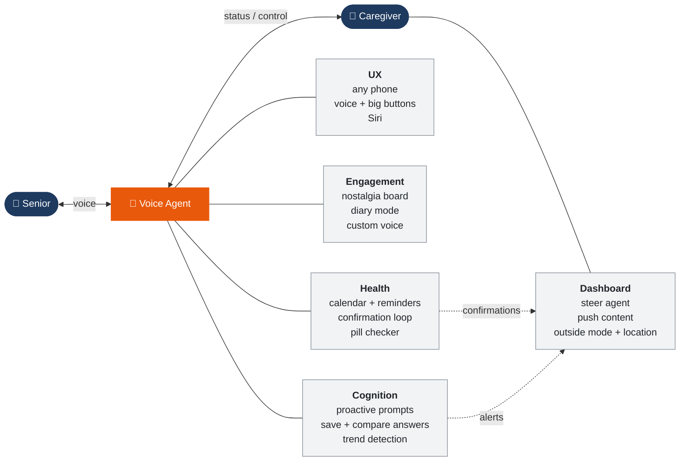

# Pilotprojektsteckbrief #6 — Mental Health bei pflegenden Angehörigen

> Proactive voice agent for seniors → relief and transparency for family caregivers.

## Problem

**Core:** Family caregivers face long-term stress, emotional strain and isolation. They are overlooked, and no low-barrier support fits their daily routine.

| Driver | Impact on caregiver |
|---|---|
| Senior lives alone | Caregiver is the only lifeline |
| Care is time-intensive | No time for self |
| Help is hard to find | Load stays with family |
| No feedback on help quality | Constant worry |
| Fewer children in DE | More load per caregiver |

## Solution

A simple, voice-first agent app for every senior that **helps with daily routines** and **gives caregivers visibility**.

## System Map

## Features

| Module | Features |
|---|---|
| **UX** | · Cross-platform app · voice-first · key actions as buttons · Siri integration · voice |
| **Senior** | Reminders · Location of caregivers · QA on interests e.g. TV Program |
| **Caregiver** | Dashboard · remote steering · status confirmations · outside mode + location · remote calendar · "Resposability tracking". |
| **Engagement** | remote family content · diary mode · quick call and call announcements |
| **Cognition** | Agent-initiated dialogues: nostalgie + response logging & change detection |
| **Health** | Calendar + reminders with confirmation · pill checker |

 

 

 

 

 

 

## Business Model

- monthly subscription mode (needed to cover voice agent and clouds storage costs)

- add-on subscriptions : Automtatic Pill purchase plan, Delivery Fee's
- Partnership with Deliverer Companies

## Open Points

- [ ] Direct caregiver mental-health feature (check-in, stress score, peer/helpline)
- [ ] Clarify "B40C" next to pill checker
- [ ] Confirm "Diary mode"
