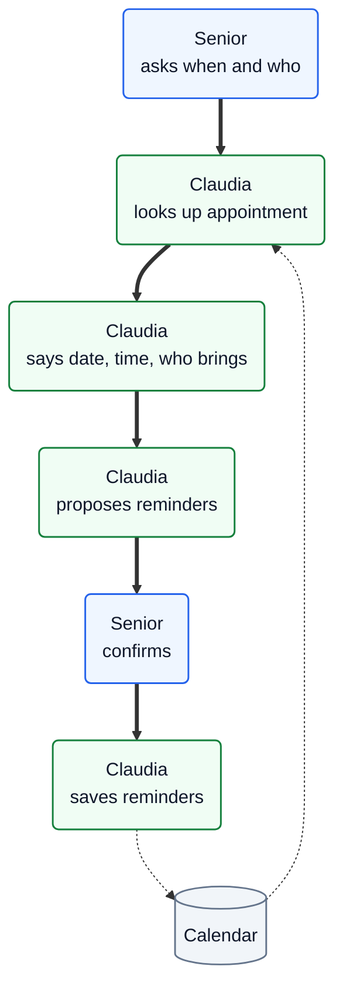
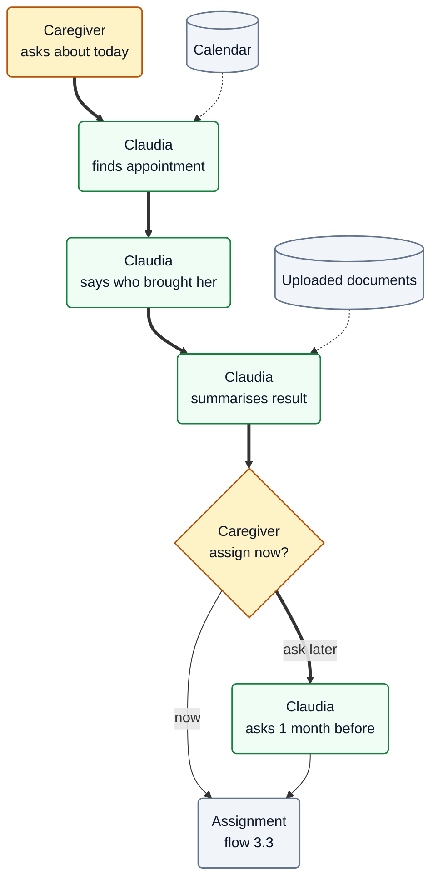
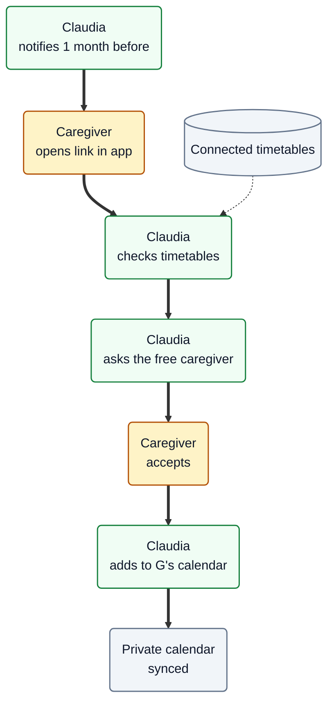
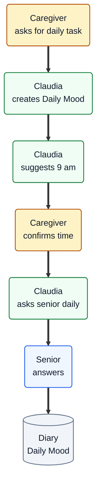
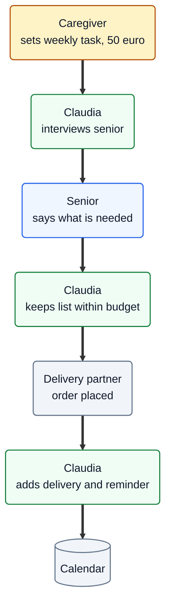
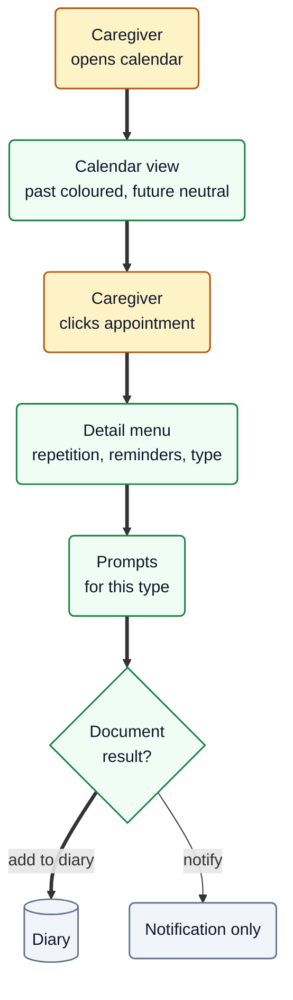

# Spec 1 — Calendar / Scheduling

> Feature notes: [`features/01-calendar.md`](../../features/01-calendar.md) · Shared requirements: [`README.md`](../README.md) · Design: [`design.html`](../../design.html) · Flows step by step: [`flows.html`](flows.html)

**Roles:** `G` = senior · `C` = family caregiver · `A` = Claudia, the voice agent
**Priority:** `M` Must · `S` Should · `C` Could · **open** = not decided yet

## Contents

- [1. Basic information](#1-basic-information)
- [2. Requirements](#2-requirements)
  - [2.1 Functional: calendar](#21-functional-calendar)
  - [2.2 Functional: recurring Claudia tasks](#22-functional-recurring-claudia-tasks)
  - [2.3 Non-functional](#23-non-functional)
- [3. Flows](#3-flows)
  - [How to read the graphs](#how-to-read-the-graphs)
  - [3.1 Next appointment](#31-next-appointment)
  - [3.2 Appointment check](#32-appointment-check)
  - [3.3 Assign a responsible caregiver](#33-assign-a-responsible-caregiver)
  - [3.4 Daily mood](#34-daily-mood)
  - [3.5 Weekly groceries](#35-weekly-groceries)
  - [3.6 Calendar history and appointment detail](#36-calendar-history-and-appointment-detail)
- [4. Open points](#4-open-points)

## 1. Basic information

| | |
|---|---|
| Goal | One shared calendar for `G` and the family: every appointment gets a responsible caregiver, both sides get reminders, and Claudia runs scheduled tasks |
| Used by | `G` by voice · `C` by voice, companion app and web dashboard |
| Builds on | Diary (answers and results are documented) · `C`'s private calendar (sync) · delivery partner (orders) |
| Scheduled actions | `Ask` → document the answer · `Stock reminder` → initiate ordering |
| Demo | Six flows, playable step by step in [`flows.html`](flows.html). People, dates and example answers in it are made up |

## 2. Requirements

### 2.1 Functional: calendar

| ID | Requirement | Who | Prio | Status |
|---|---|---|---|---|
| CAL-1 | One internal calendar shared by `G` and the family | G, C | M | defined |
| CAL-2 | `G` and `C` can both create events (`G` by voice, `C` by voice or UI) | G, C | M | defined |
| CAL-3 | Sync with `C`'s personal calendar | C | M | provider **open** |
| CAL-4 | Scheduled action `Ask`: `A` asks `G` a predefined question and logs the answer in the diary | A, G | M | defined |
| CAL-5 | Scheduled action `Stock reminder`: initiates ordering | A | M | ordering path **open** |
| CAL-6 | Availability check of caregivers for an appointment | A, C | M | defined |
| CAL-7 | Shift the appointment or assign a responsible `C` | A, C | M | who decides the shift is **open** |
| CAL-8 | Reminders for `C` and `G`, configurable in the calendar | G, C | M | defined |
| CAL-9 | `G` asks for the next appointment and who brings them; `A` answers with exact date, time and the caregiver who accepted | G | M | flow 3.1 |
| CAL-10 | `A` proposes a reminder plan (3 days ahead and the day before) and `G` confirms by voice | A, G | M | flow 3.1 |
| CAL-11 | `C` asks about a past appointment; `A` reports who accompanied `G` and how it went | C | M | flow 3.2 |
| CAL-12 | Outcome is read from uploaded documents ("all fine, no action needed") | A | M | who uploads, and how, is **open** |
| CAL-13 | `A` proposes the follow-up appointment: assign now, or ask one month before | A, C | M | flow 3.2 |
| CAL-14 | `A` notifies `C` ahead of an unassigned appointment; the link opens the assignment in the companion app | A, C | M | flow 3.3 |
| CAL-15 | `A` checks all connected timetables and suggests the caregiver who is free | A | M | flow 3.3 |
| CAL-16 | On acceptance the appointment goes into `G`'s calendar and is synced to `C`'s private calendar | A | M | extends CAL-3 |
| CAL-17 | Calendar shows status by colour (past: done, rescheduled, missed; future: neutral), plus assignee icon and location | C | M | flow 3.6 |
| CAL-18 | Appointment detail: repetition, reminder settings, type, type-specific prompts, "document result" checkbox, documentation location (notification only / add to diary) | C | M | flow 3.6 |

### 2.2 Functional: recurring Claudia tasks

| ID | Requirement | Who | Prio | Status |
|---|---|---|---|---|
| TASK-1 | `C` creates a recurring question for `G` by voice (e.g. daily "How do you feel?") | C | M | flow 3.4 |
| TASK-2 | Answers are documented in a named diary section (e.g. "Daily Mood") | A | M | flow 3.4 |
| TASK-3 | `A` suggests a time that fits the day (9:00, after the tablet check) | A, C | M | flow 3.4 |
| TASK-4 | `C` sets up a weekly grocery task: `A` interviews `G` about what is needed | C, G | M | flow 3.5 |
| TASK-5 | Order is capped at a budget set by `C` (50 euro) | A | M | behaviour over budget **open** |
| TASK-6 | `A` places the order with a delivery partner (Flink named as example) | A | M | partnership and payment **open** |
| TASK-7 | Delivery date and a reminder are added to `G`'s calendar | A | M | flow 3.5 |

### 2.3 Non-functional

Shared requirements (simplicity, voice first, legibility, platform, language, response time) are in [`README.md`](../README.md).

| ID | Area | Requirement | Status |
|---|---|---|---|
| CAL-N1 | Privacy | Connected timetables and uploaded documents are personal data; sharing needs consent | model **open** |
| CAL-N2 | Medical results | Clear limit on how far Claudia may interpret an uploaded result | **open** |
| CAL-N3 | Budget | A budget set by `C` is a hard limit for any order | behaviour over budget **open** |
| CAL-N4 | Calendar sync | An accepted appointment appears in `G`'s calendar and `C`'s private calendar | provider **open** |

## 3. Flows

| # | Flow | Started by | Result |
|---|---|---|---|
| 1 | [Next appointment](flows.html#1) | `G` | Reminder plan confirmed and saved (3 days before, the day before) |
| 2 | [Appointment check](flows.html#2) | `C` | Outcome reported; follow-up assigned now or asked one month before |
| 3 | [Assign a responsible caregiver](flows.html#3) | Claudia | Appointment in `G`'s calendar, synced to `C`'s private calendar |
| 4 | [Daily mood](flows.html#4) | `C` | Daily answer documented in the diary under "Daily Mood" |
| 5 | [Weekly groceries](flows.html#5) | `C` | Order placed; delivery date and reminder in `G`'s calendar |
| 6 | [Calendar history and appointment detail](flows.html#6) | `C` | Past status readable by colour; settings of one appointment editable |

### How to read the graphs

Vertex-edge graphs. Thick edges are the main path; thin edges are branches; dotted edges are side effects.

| Colour | Who |
|---|---|
| Blue | Senior (`G`) |
| Amber | Caregiver (`C`) |
| Green | Claudia |
| Grey | Stored information and outside services |

### 3.1 Next appointment

| | |
|---|---|
| Started by | `G` |
| Trigger | "Hey Claudia, when is my next dentist appointment and who could bring me?" |
| Result | Reminder plan confirmed and saved (3 days before, the day before) |
| Step by step | [`flows.html#1`](flows.html#1) |

- Covers: CAL-8, CAL-9, CAL-10
- **Open:** what `A` says when nobody has accepted yet

### 3.2 Appointment check

| | |
|---|---|
| Started by | `C` |
| Trigger | "Hey Claudia, my mum had a dentist appointment today. Could you check?" |
| Result | Outcome reported; follow-up assigned now or asked one month before |
| Step by step | [`flows.html#2`](flows.html#2) |

- Covers: CAL-11, CAL-12, CAL-13
- **Open:** who uploads the documents and in which form; how far `A` may interpret a medical result

### 3.3 Assign a responsible caregiver

| | |
|---|---|
| Started by | Claudia |
| Trigger | Notification to `C` one month before an unassigned appointment |
| Result | Appointment in `G`'s calendar, synced to `C`'s private calendar |
| Step by step | [`flows.html#3`](flows.html#3) |

- Covers: CAL-6, CAL-7, CAL-14, CAL-15, CAL-16
- **Open:** what happens when `C` declines or nobody is free; which calendars can be connected

### 3.4 Daily mood

| | |
|---|---|
| Started by | `C` |
| Trigger | "Hey Claudia, could you add a daily task that asks how my mum feels and add it to the diary?" |
| Result | Daily answer documented in the diary under "Daily Mood" |
| Step by step | [`flows.html#4`](flows.html#4) |

- Covers: CAL-4, TASK-1, TASK-2, TASK-3
- **Open:** whether `C` is told when the mood changes (change detection is listed in `project.md`)

### 3.5 Weekly groceries

| | |
|---|---|
| Started by | `C` |
| Trigger | "Hey Claudia, ask my mum every week if she needs groceries. Keep the order within 50 euro, order at Flink, and add the delivery date and a reminder to her calendar." |
| Result | Order placed; delivery date and reminder in `G`'s calendar |
| Step by step | [`flows.html#5`](flows.html#5) |

- Covers: CAL-5, TASK-4 to TASK-7; ties to the delivery add-on in the business model
- **Open:** what `A` does when the list exceeds 50 euro; payment; whether `C` approves each order; Flink is the named example, no partnership exists yet

### 3.6 Calendar history and appointment detail

| | |
|---|---|
| Started by | `C` |
| Trigger | `C` opens the calendar and selects an appointment |
| Result | Past status readable by colour; settings of one appointment editable |
| Step by step | [`flows.html#6`](flows.html#6) |

| Where | Colour | Meaning | How often |
|---|---|---|---|
| Past | Green | Took place | Most |
| Past | Yellow | Rescheduled | Rare |
| Past | Red | Missed | Very rare |
| Future | Neutral | Planned | All |

- Every appointment shows an icon of who is assigned and its location.
- In `design.html` these map to the existing status scale: lime, amber, coral.

Detail menu of one appointment:

| Detail menu item | Control |
|---|---|
| Repetition | Setting |
| Reminder settings | Setting |
| Type | Setting |
| Prompts / questions for this type | List |
| Document result | Checkbox |
| Documentation location | Dropdown: notification only · add to diary |

- Covers: CAL-17, CAL-18
- **Open:** list of appointment types and their prompts; whether `G` sees any of this

## 4. Open points

- [ ] Order of the six flows and which one is shown live
- [ ] Screens missing in `design.html`: recurring task setup, groceries, calendar history colours, appointment detail menu, notification
- [ ] Uploaded documents: who uploads, format, how far Claudia may interpret results
- [ ] Declined or unfilled assignment: what Claudia does next
- [ ] Who confirms a shifted appointment
- [ ] Grocery order: over budget, payment, approval by `C`, delivery partner
- [ ] Appointment types and their prompts
- [ ] External calendar provider
