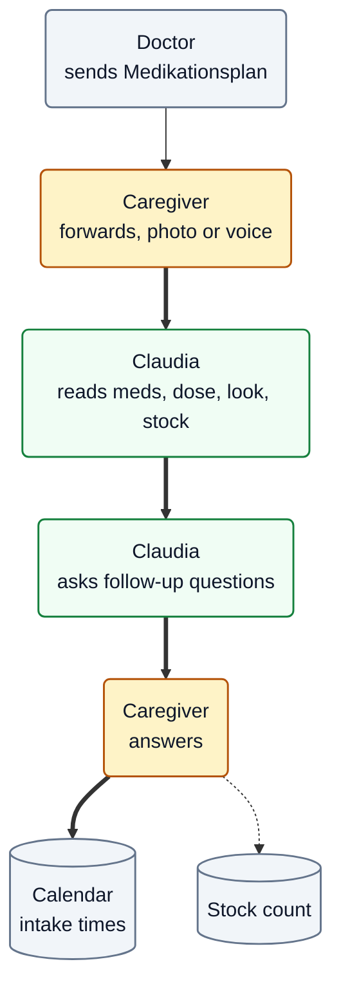
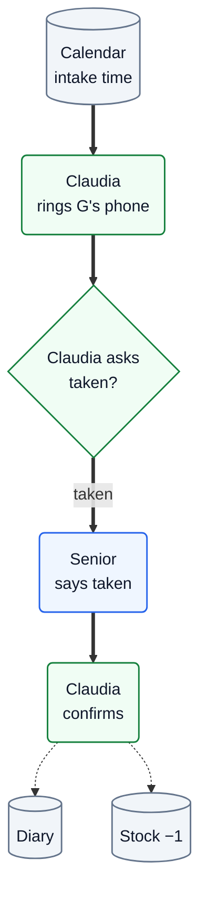
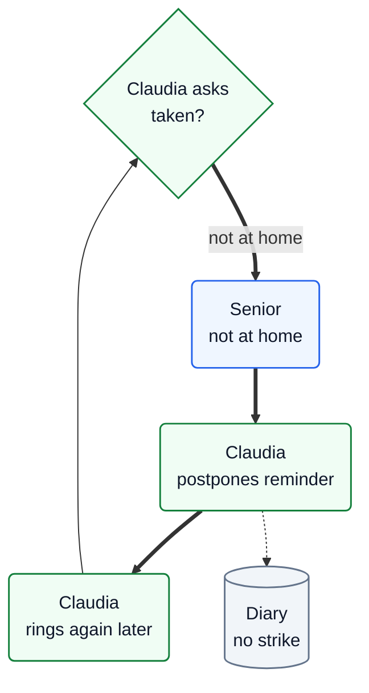
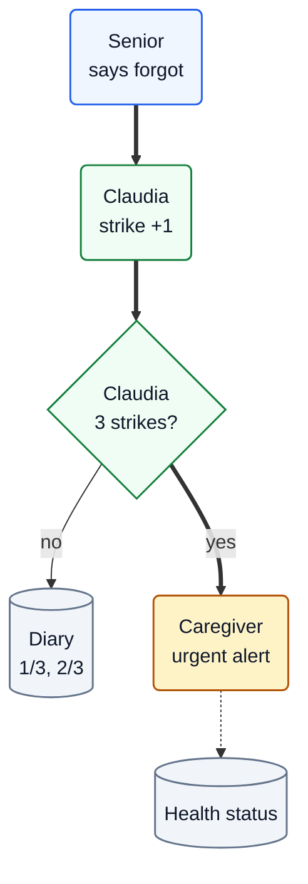
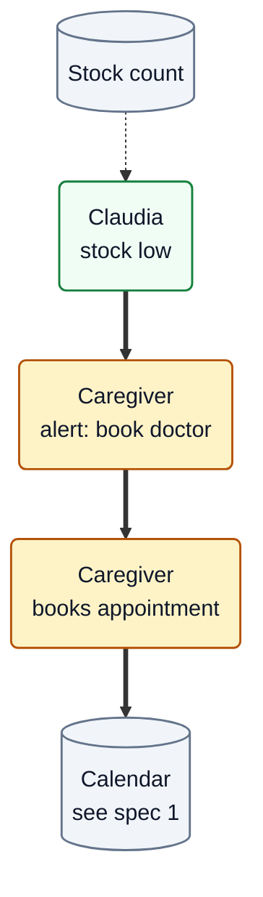
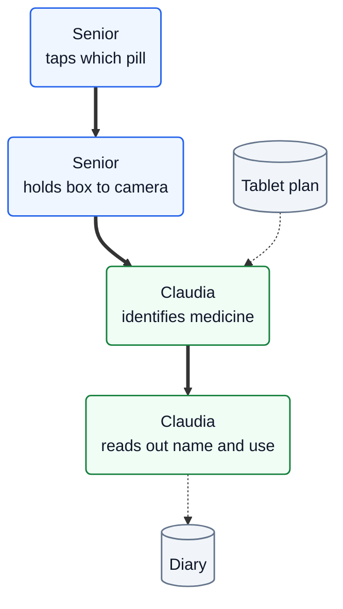

# Spec 2 — Pill Checker

> Feature notes: [`features/02-pill-checker.md`](../../features/02-pill-checker.md) · Shared requirements: [`README.md`](../README.md) · Design: [`design.html`](../../design.html) · Flows step by step: [`flows.html`](flows.html)

**Roles:** `G` = senior · `C` = family caregiver · `A` = Claudia, the voice agent
**Priority:** `M` Must · `S` Should · `C` Could · **open** = not decided yet

## Contents

- [1. Basic information](#1-basic-information)
- [2. Requirements](#2-requirements)
  - [2.1 Functional: setup](#21-functional-setup)
  - [2.2 Functional: daily check](#22-functional-daily-check)
  - [2.3 Functional: safeguards](#23-functional-safeguards)
  - [2.4 Non-functional](#24-non-functional)
- [3. Flows](#3-flows)
  - [How to read the graphs](#how-to-read-the-graphs)
  - [3.1 Set up the plan](#31-set-up-the-plan)
  - [3.2 Taken](#32-taken)
  - [3.3 Not at home](#33-not-at-home)
  - [3.4 Forgot, and the 3 strikes](#34-forgot-and-the-3-strikes)
  - [3.5 Low stock](#35-low-stock)
  - [3.6 Which pill is this?](#36-which-pill-is-this)
- [4. Open points](#4-open-points)

## 1. Basic information

| | |
|---|---|
| Goal | `G` takes the tablets on time; `C` hears about it only when something is off |
| Used by | `C` (or the doctor) sends the prescription · `G` answers the check by voice or with a button |
| Setup | Prescription or *Medikationsplan* by email, WhatsApp or messenger, a photo, or by voice. `A` reads medicines, dose, look and stock, then asks the follow-up questions herself |
| Daily check | `A` rings `G`'s phone at each intake time and asks gently. Three answers: Taken (`Genommen`), Not at home (`Nicht zu Hause`), Forgot (`Vergessen`) |
| Builds on | Calendar (intake times are events) · diary (every ring, answer, strike, scan and stock warning is documented) · calendar flow for booking the doctor |
| Demo | Six flows, playable step by step in [`flows.html`](flows.html); PNGs in [`img/`](img/). People, medicines, times and numbers in it are made up |

## 2. Requirements

### 2.1 Functional: setup

| ID | Requirement | Who | Prio | Status |
|---|---|---|---|---|
| PILL-1 | Setup from the prescription: sent by email, WhatsApp or messenger, uploaded as a photo, or dictated to `A` by voice | C | M | flow 3.1 |
| PILL-9 | `A` reads each medicine: name, dose, visual appearance, stock count | A | M | flow 3.1 |
| PILL-10 | Right after an upload `A` confirms what she sees and asks follow-up questions (reminders, times, pills in the box) | A, C | M | flow 3.1 |
| PILL-2 | Intake times are calendar events | A | M | flow 3.1 |

### 2.2 Functional: daily check

| ID | Requirement | Who | Prio | Status |
|---|---|---|---|---|
| PILL-11 | At each intake time `A` rings `G`'s phone so the reminder is not ignored | A | M | flow 3.2 |
| PILL-3 | `A` asks `G` gently whether the tablets are taken; `G` answers by voice or with one of three buttons | A, G | M | flow 3.2 |
| PILL-4 | Taken → logged in the diary, stock count −1 | A | M | flow 3.2 |
| PILL-5 | Not at home → reminder postponed to a later time, logged, no strike | A, G | M | how much later, and how often, **open**; flow 3.3 |
| PILL-6 | Forgot → strike +1 (1/3, 2/3); at 3 strikes an urgent alert to the family and the health status changes | A, C | M | reset rule **open**; flow 3.4 |
| PILL-12 | No answer to the ring | A | M | treat as Forgot? **open** |

### 2.3 Functional: safeguards

| ID | Requirement | Who | Prio | Status |
|---|---|---|---|---|
| PILL-13 | Low stock → `A` alerts `C` to book the doctor for a new prescription | A, C | M | threshold **open**; flow 3.5 |
| PILL-14 | "Which pill is this?": `G` taps the button, the camera opens, `A` identifies the medicine and reads out what it is and how to take it | G, A | M | flow 3.6 |
| PILL-15 | Full audit log: every ring, answer, strike, scan and stock warning in the caregiver diary | A, C | M | flows 3.2 to 3.6 |
| PILL-7 | Verification by camera or sensor instead of asking | G | M | not in the refined notes; camera is now used to identify (PILL-14). Keep? **open** |
| PILL-8 | Quick help | G | M | not in the refined notes; content **open** |

### 2.4 Non-functional

Shared requirements (simplicity, voice first, legibility, platform, language, response time) are in [`README.md`](../README.md).

| ID | Area | Requirement | Status |
|---|---|---|---|
| PILL-N1 | Escalation | A missed intake reaches `C` at the latest at 3 strikes | reset rule and no-answer case **open** |
| PILL-N2 | Privacy | Medication plan and intake history are health data; access needs consent | model **open** |
| PILL-N3 | Calm tone | The check is gentle; a forgotten dose is never blamed | defined |
| PILL-N4 | Reading accuracy | What `A` reads from a prescription or a camera scan is confirmed before it is used | who confirms **open** |
| PILL-N5 | Stock accuracy | The stock count follows Taken answers; a mismatch with the real box is possible | correction method **open** |

## 3. Flows

| # | Flow | Started by | Result |
|---|---|---|---|
| 1 | [Set up the plan](flows.html#1) | `C` | Medicines read, follow-up answered, intake times in the calendar |
| 2 | [Taken](flows.html#2) | Claudia | Intake logged, stock −1 |
| 3 | [Not at home](flows.html#3) | Claudia | Reminder postponed, logged, no strike |
| 4 | [Forgot, and the 3 strikes](flows.html#4) | Claudia | Strike counted; at 3 strikes the family is alerted |
| 5 | [Low stock](flows.html#5) | Claudia | `C` books the doctor for a new prescription |
| 6 | [Which pill is this?](flows.html#6) | `G` | `A` names the medicine and how to take it |

### How to read the graphs

Vertex-edge graphs. Thick edges are the main path; thin edges are branches; dotted edges are side effects.

| Colour | Who |
|---|---|
| Blue | Senior (`G`) |
| Amber | Caregiver (`C`) |
| Green | Claudia |
| Grey | Stored information and outside services |

### 3.1 Set up the plan

| | |
|---|---|
| Started by | `C` |
| Trigger | The *Medikationsplan* arrives by email or WhatsApp; `C` forwards it, uploads a photo, or sets it up by voice |
| Result | Medicines read, follow-up answered, intake times in the calendar |
| Step by step | [`flows.html#1`](flows.html#1) |
| Images | [`img/set-up-the-plan-overview.png`](img/set-up-the-plan-overview.png) and steps in [`img/`](img/) |

- Covers: PILL-1, PILL-2, PILL-9, PILL-10
- **Open:** who confirms what `A` read; can `G` set up by voice alone

### 3.2 Taken

| | |
|---|---|
| Started by | Claudia |
| Trigger | Intake time in the calendar |
| Result | Intake logged, stock −1 |
| Step by step | [`flows.html#2`](flows.html#2) |
| Images | [`img/taken-overview.png`](img/taken-overview.png) and steps in [`img/`](img/) |

- Covers: PILL-3, PILL-4, PILL-11, PILL-15
- **Open:** what happens when nobody answers the ring (PILL-12)

### 3.3 Not at home

| | |
|---|---|
| Started by | Claudia |
| Trigger | `G` answers "Not at home" |
| Result | Reminder postponed, logged, no strike |
| Step by step | [`flows.html#3`](flows.html#3) |
| Images | [`img/not-at-home-overview.png`](img/not-at-home-overview.png) and steps in [`img/`](img/) |

- Covers: PILL-5, PILL-15
- **Open:** how much later; how many postpones before it counts as a strike

### 3.4 Forgot, and the 3 strikes

| | |
|---|---|
| Started by | Claudia |
| Trigger | `G` answers "Forgot" |
| Result | Strike counted; at 3 strikes the family is alerted |
| Step by step | [`flows.html#4`](flows.html#4) |
| Images | [`img/forgot-overview.png`](img/forgot-overview.png) and steps in [`img/`](img/) |

- Covers: PILL-6, PILL-15
- **Open:** strike reset (per day, per medicine, after `C` acknowledges)

### 3.5 Low stock

| | |
|---|---|
| Started by | Claudia |
| Trigger | Stock count falls below the threshold |
| Result | `C` books the doctor for a new prescription |
| Step by step | [`flows.html#5`](flows.html#5) |
| Images | [`img/low-stock-overview.png`](img/low-stock-overview.png) and steps in [`img/`](img/) |

- Covers: PILL-13, PILL-15
- **Open:** threshold (days of supply left); link to automatic pill purchase add-on in the business model

### 3.6 Which pill is this?

| | |
|---|---|
| Started by | `G` |
| Trigger | `G` taps "Which pill is this?" |
| Result | `A` names the medicine and how to take it |
| Step by step | [`flows.html#6`](flows.html#6) |
| Images | [`img/which-pill-overview.png`](img/which-pill-overview.png) and steps in [`img/`](img/) |

- Covers: PILL-14, PILL-15
- **Open:** a medicine not on the plan; can it be started by voice too

## 4. Open points

- [ ] Which flow is shown live in the pitch
- [ ] Strike counter reset: per day, per medicine, or after `C` acknowledges
- [ ] Low-stock threshold (days of supply left)
- [ ] "Not at home": how much later, how many times before it counts as a strike
- [ ] No answer to the ring: treat as Forgot?
- [ ] Who confirms what `A` read from a prescription or a scan
- [ ] Camera verification (PILL-7) and "Quick help" (PILL-8): keep or drop
- [ ] Pill box with sensors is `C` (Could): out of demo scope?
