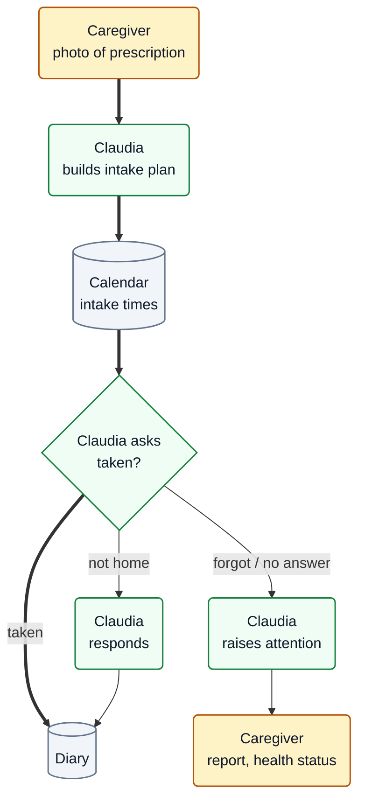

# Spec 2 — Pill Checker

> Feature notes: [`features/02-pill-checker.md`](../../features/02-pill-checker.md) · Shared requirements: [`README.md`](../README.md) · Design: [`design.html`](../../design.html)

**Roles:** `G` = senior · `C` = family caregiver · `A` = Claudia, the voice agent
**Priority:** `M` Must · `S` Should · `C` Could · **open** = not decided yet

## Contents

- [1. Basic information](#1-basic-information)
- [2. Requirements](#2-requirements)
  - [2.1 Functional](#21-functional)
  - [2.2 Non-functional](#22-non-functional)
- [3. Flows](#3-flows)
  - [How to read the graphs](#how-to-read-the-graphs)
  - [3.1 Tablets: from prescription photo to daily check](#31-tablets-from-prescription-photo-to-daily-check)
- [4. Open points](#4-open-points)

## 1. Basic information

| | |
|---|---|
| Goal | `G` takes the tablets on time; `C` hears about it only when something is off |
| Used by | `C` sets up the plan from a prescription photo · `G` confirms by voice |
| Builds on | Calendar (intake times are events) · diary (every answer is documented) |
| Demo | Voice confirmation ("just ask"); camera or sensor check is **open** |

## 2. Requirements

### 2.1 Functional

| ID | Requirement | Who | Prio | Status |
|---|---|---|---|---|
| PILL-1 | Setup from a picture of the prescription: picture → plan → config | C | M | defined |
| PILL-2 | Intake times are calendar events | A | M | defined |
| PILL-3 | `A` asks `G` at the scheduled time; `G` confirms by voice | A, G | M | defined |
| PILL-4 | Taken → documented in the diary | A | M | defined |
| PILL-5 | Not home → response + documented | A, G | M | detection **open** |
| PILL-6 | Forgot / no answer → raise attention → report to `C` (health status) | A, C | M | thresholds **open** |
| PILL-7 | Verification by camera or sensor instead of asking | G | M | method for demo **open** |
| PILL-8 | Quick help | G | M | content **open** |

### 2.2 Non-functional

Shared requirements (simplicity, voice first, legibility, platform, language, response time) are in [`README.md`](../README.md).

| ID | Area | Requirement | Status |
|---|---|---|---|
| PILL-N1 | Escalation | A missed or unanswered intake reaches `C` | retries and delay **open** |
| PILL-N2 | Privacy | Medication plan and intake history are health data; access needs consent | model **open** |

## 3. Flows

### How to read the graphs

Vertex-edge graphs. Thick edges are the main path; thin edges are branches; dotted edges are side effects.

| Colour | Who |
|---|---|
| Blue | Senior (`G`) |
| Amber | Caregiver (`C`) |
| Green | Claudia |
| Grey | Stored information and outside services |

### 3.1 Tablets: from prescription photo to daily check

#### Graph

#### Requirements and open points

- Covers: PILL-1 to PILL-6
- **Open:** camera vs. "just ask"; number of retries before `C` is told; how "not home" is detected

## 4. Open points

- [ ] Verification for the demo: camera or "just ask"
- [ ] Escalation thresholds (retries, delay before `C` is told)
- [ ] How "not home" is detected
- [ ] Content of "Quick help"
- [ ] Pill box with sensors is `C` (Could): out of demo scope?
