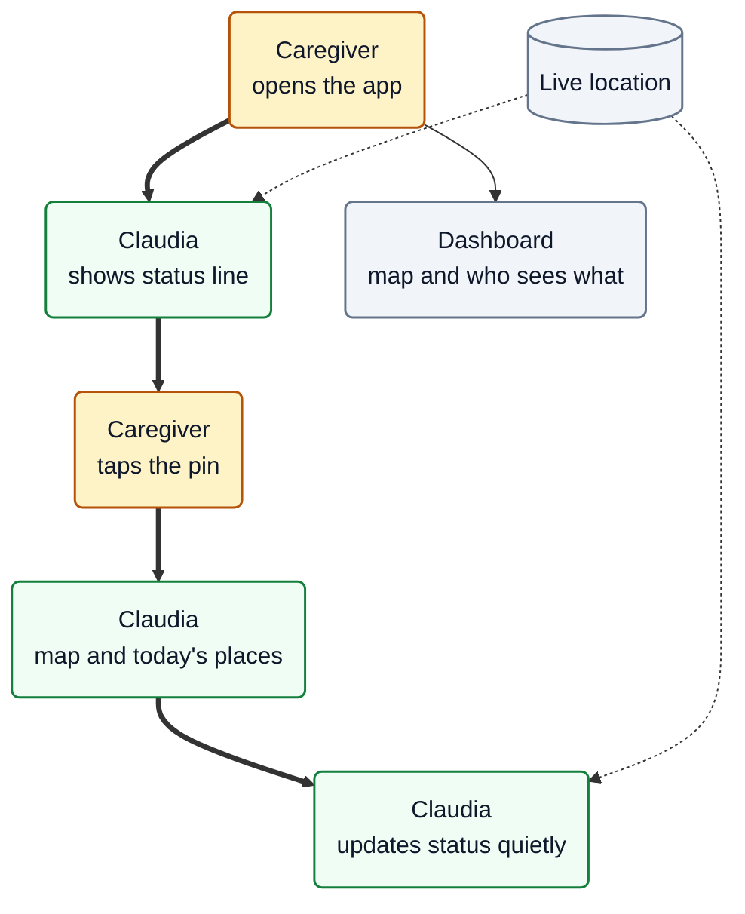
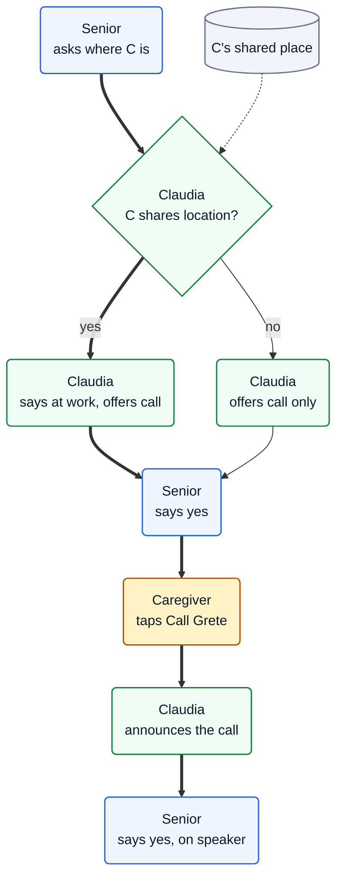
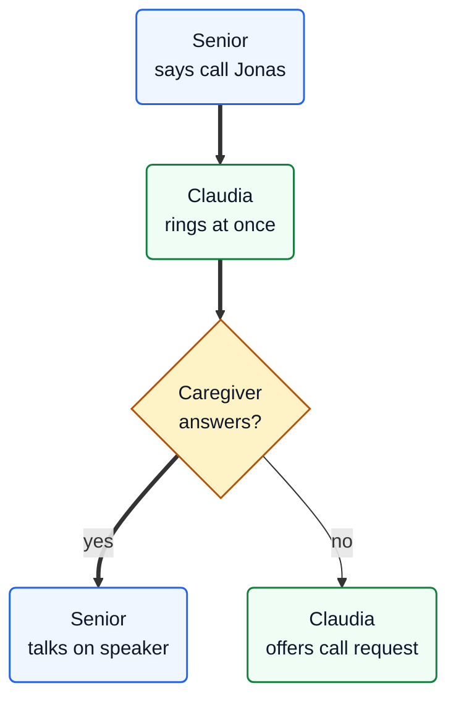
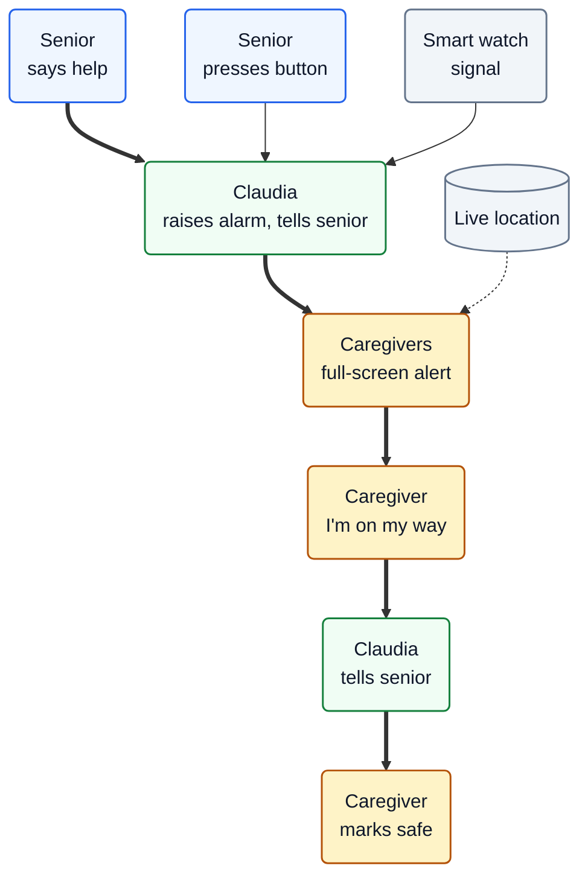
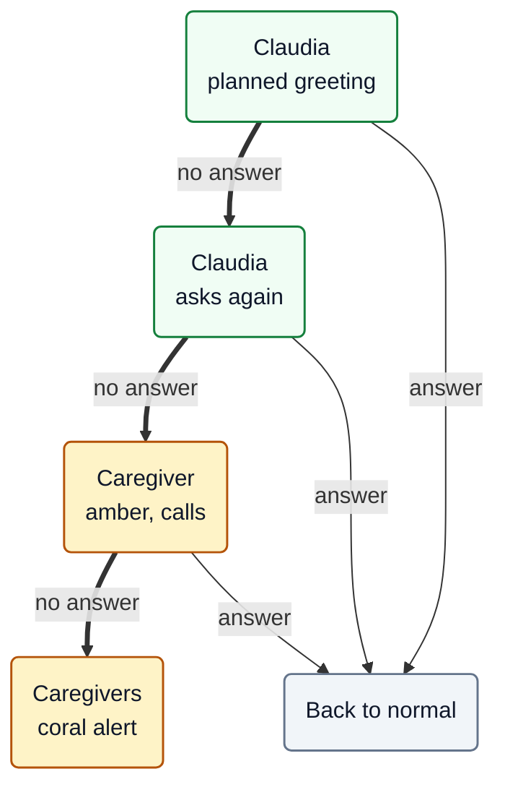

# Spec 3 — Live Location + Emergency Alert

> Feature notes: [`features/03-live-location.md`](../../features/03-live-location.md) · Shared requirements: [`README.md`](../README.md) · Design: [`design.html`](../../design.html) · Flows step by step: [`flows.html`](flows.html)

**Roles:** `G` = senior · `C` = family caregiver · `A` = Claudia, the voice agent
**Priority:** `M` Must · `S` Should · `C` Could · **open** = not decided yet

## Contents

- [1. Basic information](#1-basic-information)
- [2. Requirements](#2-requirements)
  - [2.1 Functional: location and calls](#21-functional-location-and-calls)
  - [2.2 Functional: emergency](#22-functional-emergency)
  - [2.3 Non-functional](#23-non-functional)
- [3. Flows](#3-flows)
  - [How to read the graphs](#how-to-read-the-graphs)
  - [3.1 Where is Grete?](#31-where-is-grete)
  - [3.2 Where is my son?](#32-where-is-my-son)
  - [3.3 Call Jonas](#33-call-jonas)
  - [3.4 Hey Claudia, help!](#34-hey-claudia-help)
  - [3.5 No answer](#35-no-answer)
- [4. Open points](#4-open-points)

## 1. Basic information

| | |
|---|---|
| Goal | Claudia answers "is she all right?" before `C` has to ask, and turns "something is wrong" into one clear call to action |
| Used by | `C` sees where `G` is (app and web dashboard) · `G` asks for `C`, calls, or calls for help by voice; buttons are a fallback |
| Hands-free | The wake word "Hey Claudia" starts every conversation. After that `G` only talks: no tap to start, answer or end. Claudia detects the end of speech; questions are answered by voice; calls are announced and run on speaker |
| Builds on | Live location of `G`'s phone · push notifications to `C` · consent settings in the web dashboard |
| Demo | Five flows, playable step by step in [`flows.html`](flows.html); PNGs in [`img/`](img/). People, times and places in it are made up |

## 2. Requirements

### 2.1 Functional: location and calls

| ID | Requirement | Who | Prio | Status |
|---|---|---|---|---|
| LOC-1 | `C` sees `G`'s location: place name first ("At home since 11:20"), map, today's places in order | C | M | flow 3.1 |
| LOC-2 | `G` asks where `C` is ("Where is my son?"); `A` answers with a coarse place ("at work"), never an address | G | M | lower priority, consent **open**; flow 3.2 |
| LOC-3 | `G` asks `A` to request a call ("Ask him to call me") → push to `C` with one action: Call Grete | G, C | M | flow 3.2 |
| LOC-4 | Hands-free: the wake word "Hey Claudia" starts every conversation; `G` only talks | G | M | flows 3.2 to 3.4 |
| LOC-5 | Direct call: "Hey Claudia, call Jonas" rings `C` at once, no question back; the *Call Jonas* button does the same | G, C | M | flow 3.3 |
| LOC-6 | Incoming calls to `G` are announced by `A` and accepted by voice, then run on speaker | A, G | M | flow 3.2 |
| LOC-7 | Normal movement never sends a push to `C`; the status line updates quietly | A | M | notify on leaving home is **open** |
| LOC-8 | Each `C` decides in the dashboard who sees `G`'s location and whether `G` may ask where they are | C | M | flow 3.1 |
| MSG-1 | Messaging inside this cluster | G, C | M | scope beyond call request and direct call **open** |

### 2.2 Functional: emergency

| ID | Requirement | Who | Prio | Status |
|---|---|---|---|---|
| EMG-5 | Emergency alert by voice: "Hey Claudia, help!" — works when `G` cannot reach the phone | G | M | flow 3.4 |
| EMG-1 | Emergency alert by button (fallback on the idle home screen) | G | M | flow 3.4 |
| EMG-2 | Emergency alert when `G` is not responding to a planned prompt | A | M | flow 3.5 |
| EMG-3 | Emergency alert from a smart watch | G | C | out of demo? **open** |
| EMG-4 | "Take action" after an alert | A, C | M | action **open**; flow 3.4 shows *I'm on my way* as example |
| EMG-6 | Every `C` gets a full-screen alert with what happened, when and where `G` is | A, C | M | flows 3.4, 3.5 |
| EMG-7 | `A` tells `G` by voice what happens next ("Jonas is on his way") | A, G | M | flow 3.4 |

### 2.3 Non-functional

Shared requirements (simplicity, voice first, legibility, platform, language, response time) are in [`README.md`](../README.md).

| ID | Area | Requirement | Status |
|---|---|---|---|
| LOC-N1 | Privacy | Location is shared only with consent, in both directions; `G` hears a coarse place, never an address | consent model and history retention **open** |
| LOC-N2 | Emergency reliability | An alert must reach `C` | target and fallback **open** |
| LOC-N3 | Hands-free | No tap needed to start, answer or end a conversation | wake word in the demo **open** |
| LOC-N4 | Always listening | Wake word detection runs all day | battery, privacy, false triggers **open** |
| LOC-N5 | Calm by default | Only "needs someone" (amber) and "act now" (coral) interrupt `C` | defined |

## 3. Flows

| # | Flow | Started by | Result |
|---|---|---|---|
| 1 | [Where is Grete?](flows.html#1) | `C` | `C` knows where `G` is without calling; no push needed |
| 2 | [Where is my son?](flows.html#2) | `G` | Coarse answer, call request sent, call back on speaker |
| 3 | [Call Jonas](flows.html#3) | `G` | `G` and `C` talk on speaker, started by voice only |
| 4 | [Hey Claudia, help!](flows.html#4) | `G` | All caregivers alerted; one is on the way; `G` is safe |
| 5 | [No answer](flows.html#5) | Claudia | Silence escalates from amber to a coral alert for everyone |

### How to read the graphs

Vertex-edge graphs. Thick edges are the main path; thin edges are branches; dotted edges are side effects.

| Colour | Who |
|---|---|
| Blue | Senior (`G`) |
| Amber | Caregiver (`C`) |
| Green | Claudia |
| Grey | Stored information and outside services |

### 3.1 Where is Grete?

| | |
|---|---|
| Started by | `C` |
| Trigger | Jonas opens the app |
| Result | `C` knows where `G` is without calling; no push needed |
| Step by step | [`flows.html#1`](flows.html#1) |
| Images | [`img/where-is-grete-overview.png`](img/where-is-grete-overview.png) and steps in [`img/`](img/) |

- Covers: LOC-1, LOC-7, LOC-8
- **Open:** notify `C` when `G` leaves home; who sets known places; location source for the demo

### 3.2 Where is my son?

| | |
|---|---|
| Started by | `G` |
| Trigger | "Hey Claudia, where is my son?" |
| Result | Coarse answer, call request sent, call back on speaker |
| Step by step | [`flows.html#2`](flows.html#2) |
| Images | [`img/where-is-my-son-overview.png`](img/where-is-my-son-overview.png) and steps in [`img/`](img/) |

- Covers: LOC-2, LOC-3, LOC-4, LOC-6
- **Open:** "G sees C" in the demo or not; consent of `C`; auto-answer on speaker vs. ask first

### 3.3 Call Jonas

| | |
|---|---|
| Started by | `G` |
| Trigger | "Hey Claudia, call Jonas" (or the *Call Jonas* button) |
| Result | `G` and `C` talk on speaker, started by voice only |
| Step by step | [`flows.html#3`](flows.html#3) |
| Images | [`img/call-jonas-overview.png`](img/call-jonas-overview.png) and steps in [`img/`](img/) |

- Covers: LOC-4, LOC-5, MSG-1
- **Open:** what happens when `C` does not pick up (call request as in 3.2, voicemail)

### 3.4 Hey Claudia, help!

| | |
|---|---|
| Started by | `G` |
| Trigger | "Hey Claudia, help!" (or the Emergency button) |
| Result | All caregivers alerted; one is on the way; `G` is safe |
| Step by step | [`flows.html#4`](flows.html#4) |
| Images | [`img/help-overview.png`](img/help-overview.png) and steps in [`img/`](img/) |

- Covers: EMG-1, EMG-3, EMG-4, EMG-5, EMG-6, EMG-7
- **Open:** what "take action" is (call `C`, emergency services, escalation chain); `G` cancels by voice ("I'm all right"); smart watch in the demo or not

### 3.5 No answer

| | |
|---|---|
| Started by | Claudia |
| Trigger | Planned greeting at 8:00 gets no answer |
| Result | Silence escalates from amber to a coral alert for everyone |
| Step by step | [`flows.html#5`](flows.html#5) |
| Images | [`img/no-answer-overview.png`](img/no-answer-overview.png) and steps in [`img/`](img/) |

- Covers: EMG-2, EMG-6
- **Open:** number of retries, delays, which prompts count

## 4. Open points

- [ ] Which flow is shown live in the pitch
- [ ] What happens after an emergency alert (who is called, in which order, emergency services)
- [ ] `G` cancels an emergency by voice: allowed, and within what time
- [ ] Consent and precision for "G sees C"; in the demo or not
- [ ] Not responding: retries, delays, which prompts count
- [ ] Always-on wake word: battery, privacy, false triggers; ElevenLabs support in the demo
- [ ] Auto-answer calls on speaker vs. ask first
- [ ] Direct call not answered: call request, voicemail
- [ ] Notify `C` when `G` leaves home
- [ ] Known places: who sets them
- [ ] Location source for the demo (phone GPS)
- [ ] Location history retention
- [ ] Smart watch trigger: out of demo scope?
- [ ] Messaging beyond the call request and the direct call
