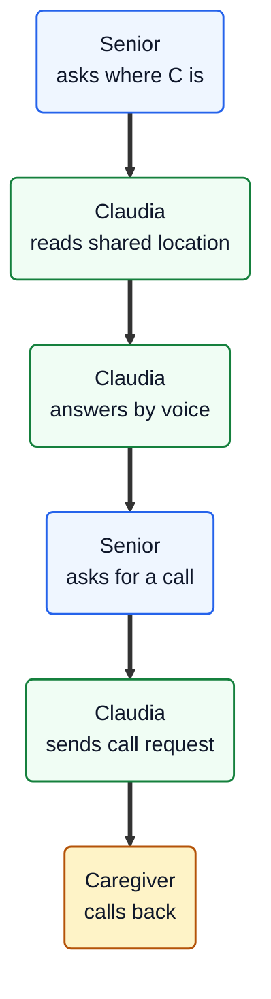
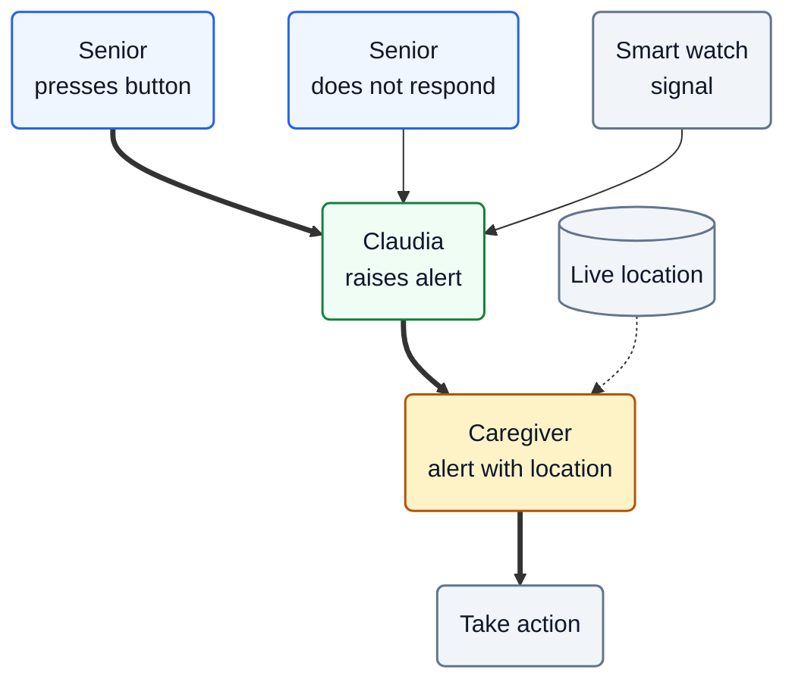

# Spec 3 — Live Location + Emergency Alert

> Feature notes: [`features/03-live-location.md`](../../features/03-live-location.md) · Shared requirements: [`README.md`](../README.md) · Design: [`design.html`](../../design.html) · Mockup: [`features/03-live-location.html`](../../features/03-live-location.html)

**Roles:** `G` = senior · `C` = family caregiver · `A` = Claudia, the voice agent
**Priority:** `M` Must · `S` Should · `C` Could · **open** = not decided yet

## Contents

- [1. Basic information](#1-basic-information)
- [2. Requirements](#2-requirements)
  - [2.1 Functional](#21-functional)
  - [2.2 Non-functional](#22-non-functional)
- [3. Flows](#3-flows)
  - [How to read the graphs](#how-to-read-the-graphs)
  - [3.1 "Where is my son?"](#31-where-is-my-son)
  - [3.2 Emergency alert](#32-emergency-alert)
- [4. Open points](#4-open-points)

## 1. Basic information

| | |
|---|---|
| Goal | Claudia answers "is she all right?" before `C` has to ask, and turns "something is wrong" into one clear call to action |
| Used by | `C` sees where `G` is · `G` asks for `C`, calls, or raises an alert by voice or button |
| Builds on | Hands-free wake word "Hey Claudia" · push notifications to `C` |
| Demo | Interactive mockup in [`features/03-live-location.html`](../../features/03-live-location.html) |

## 2. Requirements

### 2.1 Functional

| ID | Requirement | Who | Prio | Status |
|---|---|---|---|---|
| LOC-1 | `C` sees `G`'s location | C | M | defined |
| LOC-2 | `G` asks where `C` is ("Where is my son?") | G | M | lower priority, consent **open** |
| LOC-3 | `G` asks `A` to request a call ("Ask him to call me") → push to `C` | G, C | M | defined |
| EMG-1 | Emergency alert by button | G | M | defined |
| EMG-2 | Emergency alert when `G` is not responding | A | M | defined |
| EMG-3 | Emergency alert from a smart watch | G | C | out of demo? **open** |
| EMG-4 | "Take action" after an alert | A, C | M | action **open** |
| MSG-1 | Messaging inside this cluster | G, C | M | scope **open** |
| LOC-4 | Hands-free: the wake word "Hey Claudia" starts every conversation; `G` only talks | G | M | defined in feature notes |
| LOC-5 | Direct call: "Hey Claudia, call Jonas" rings `C` at once | G, C | M | defined in feature notes |
| EMG-5 | Emergency alert by voice: "Hey Claudia, help!" | G | M | defined in feature notes |

### 2.2 Non-functional

Shared requirements (simplicity, voice first, legibility, platform, language, response time) are in [`README.md`](../README.md).

| ID | Area | Requirement | Status |
|---|---|---|---|
| LOC-N1 | Privacy | Location is shared only with consent, in both directions; `G` hears a coarse place, never an address | consent model and history retention **open** |
| LOC-N2 | Emergency reliability | An alert must reach `C` | target and fallback **open** |
| LOC-N3 | Hands-free | No tap needed to start, answer or end a conversation | wake word in the demo **open** |

## 3. Flows

Storyboards for five detailed flows (A to E) are in the [feature notes](../../features/03-live-location.md).

### How to read the graphs

Vertex-edge graphs. Thick edges are the main path; thin edges are branches; dotted edges are side effects.

| Colour | Who |
|---|---|
| Blue | Senior (`G`) |
| Amber | Caregiver (`C`) |
| Green | Claudia |
| Grey | Stored information and outside services |

### 3.1 "Where is my son?"

#### Graph

#### Requirements and open points

- Covers: LOC-2, LOC-3
- **Open:** how exact the answer is (place name vs. "at work"); consent of `C`

### 3.2 Emergency alert

#### Graph

#### Requirements and open points

- Covers: LOC-1, EMG-1 to EMG-4
- **Open:** what "take action" is (call `C`, emergency services, escalation chain); smart watch in the demo or not

## 4. Open points

- [ ] What happens after an emergency alert (who is called, in which order, emergency services)
- [ ] Consent and precision for "G sees C"; in the demo or not
- [ ] Not responding: retries, delays, which prompts count
- [ ] Smart watch trigger: out of demo scope?
- [ ] Messaging beyond the call request
- [ ] Further points: see the list in the [feature notes](../../features/03-live-location.md)
