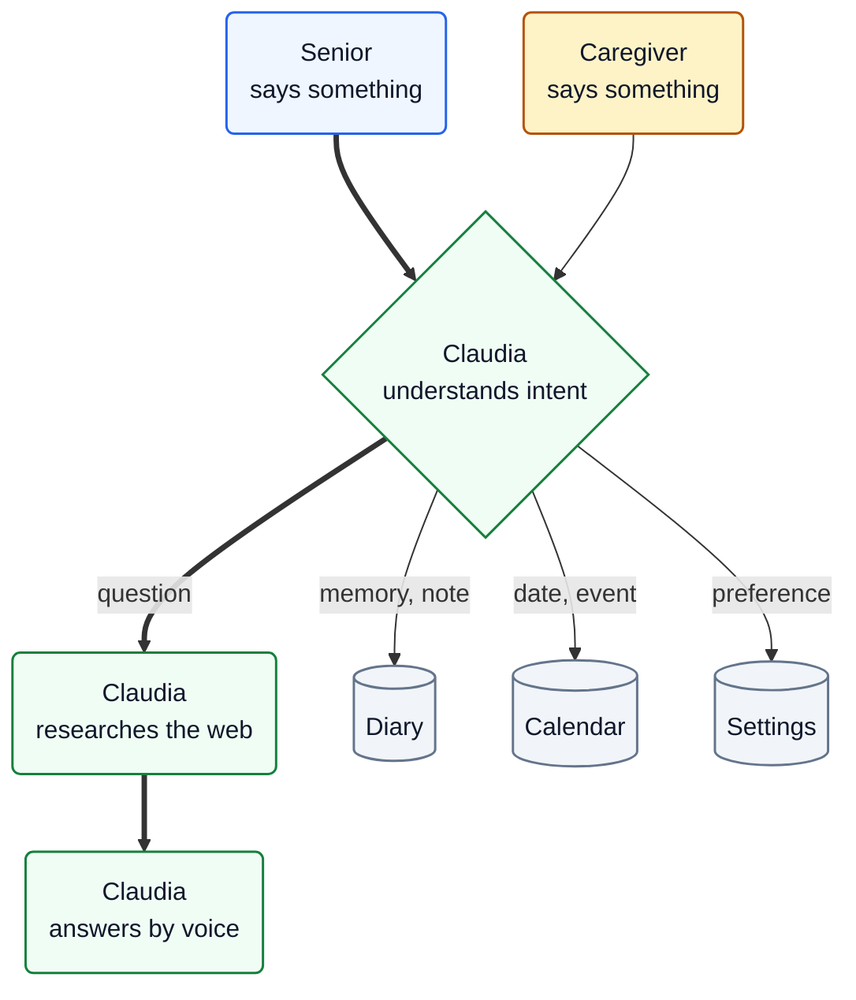

# Spec 4 — QA / Setup

> Feature notes: [`features/04-qa-setup.md`](../../features/04-qa-setup.md) · Shared requirements: [`README.md`](../README.md) · Design: [`design.html`](../../design.html)

**Roles:** `G` = senior · `C` = family caregiver · `A` = Claudia, the voice agent
**Priority:** `M` Must · `S` Should · `C` Could · **open** = not decided yet

## Contents

- [1. Basic information](#1-basic-information)
- [2. Requirements](#2-requirements)
  - [2.1 Functional](#21-functional)
  - [2.2 Non-functional](#22-non-functional)
- [3. Flows](#3-flows)
  - [How to read the graphs](#how-to-read-the-graphs)
  - [3.1 Talk to the agent](#31-talk-to-the-agent)
- [4. Open points](#4-open-points)

## 1. Basic information

| | |
|---|---|
| Goal | One entry point: talk to Claudia. She routes what was said to the diary, the calendar, the web or the settings |
| Used by | `G` and `C` |
| Builds on | Diary · calendar · settings · web research |
| Demo | Live voice conversation (ElevenLabs) |

## 2. Requirements

### 2.1 Functional

| ID | Requirement | Who | Prio | Status |
|---|---|---|---|---|
| QA-1 | Single entry: talk to the agent | G, C | M | defined |
| QA-2 | Memory or note → documented in the diary | G, C | M | defined |
| QA-3 | Date or event → added to the calendar | G, C | M | defined |
| QA-4 | Question → researched on the web → voice answer | G, C | M | sources and filtering **open** |
| QA-5 | Preference or setting → config changed | G, C | M | rights of `G` vs `C` **open** |
| QA-6 | Setup / onboarding | C | M | flow not drawn, **open** |

### 2.2 Non-functional

Shared requirements (simplicity, voice first, legibility, platform, language, response time) are in [`README.md`](../README.md).

| ID | Area | Requirement | Status |
|---|---|---|---|
| QA-N1 | Permissions | Clear rule which settings `G` may change by voice and which only `C` | **open** |
| QA-N2 | Answer safety | Web answers come from safe sources | sources and filtering **open** |

## 3. Flows

### How to read the graphs

Vertex-edge graphs. Thick edges are the main path; thin edges are branches; dotted edges are side effects.

| Colour | Who |
|---|---|
| Blue | Senior (`G`) |
| Amber | Caregiver (`C`) |
| Green | Claudia |
| Grey | Stored information and outside services |

### 3.1 Talk to the agent

#### Graph

#### Requirements and open points

- Covers: QA-1 to QA-5
- **Open:** which settings `G` may change; web sources; the onboarding flow (QA-6)

## 4. Open points

- [ ] Which settings `G` may change by voice
- [ ] Onboarding / setup flow (QA-6)
- [ ] Web sources and safety filtering
- [ ] Meaning of the board arrows diary / web → change config
