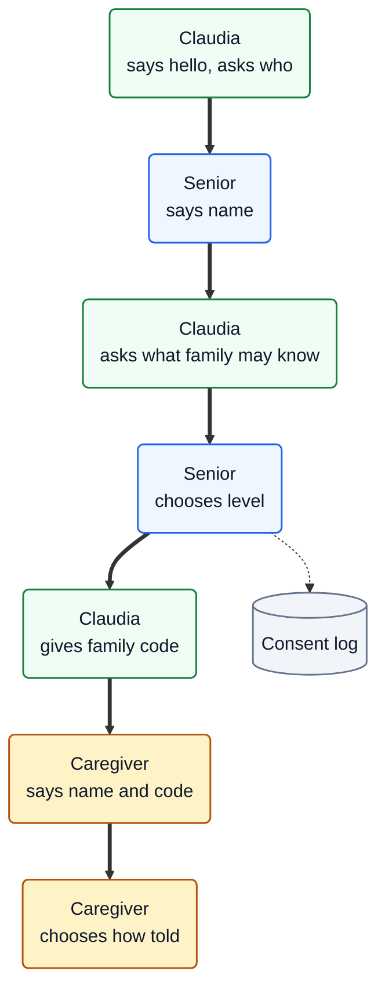
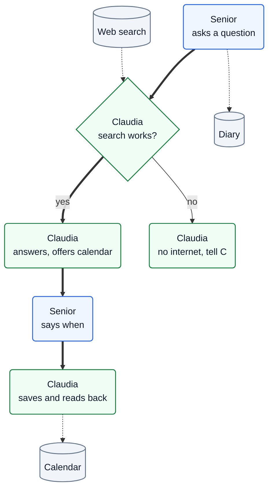
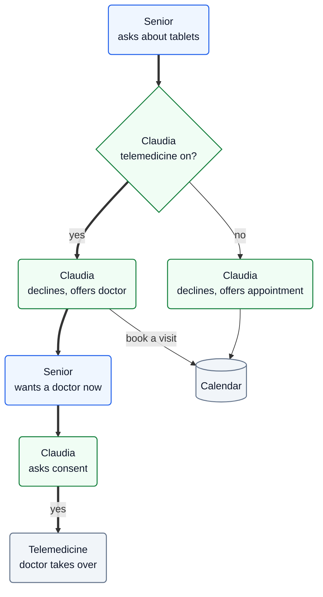
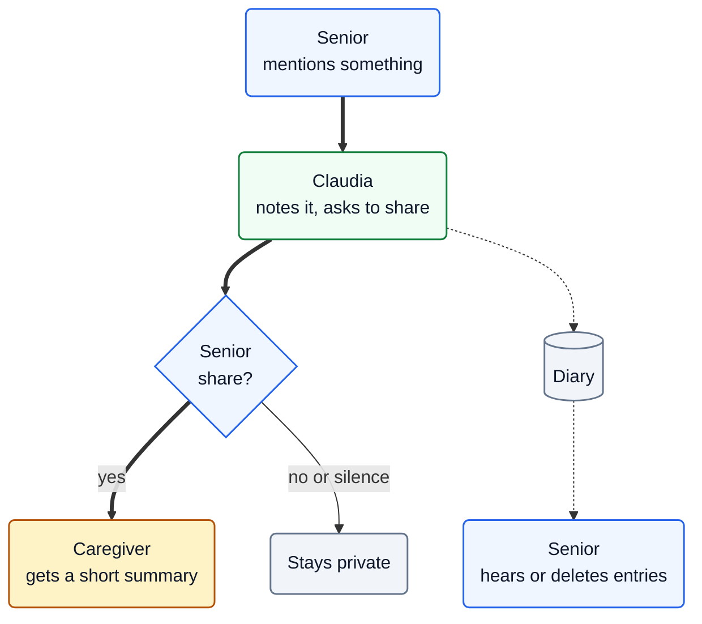
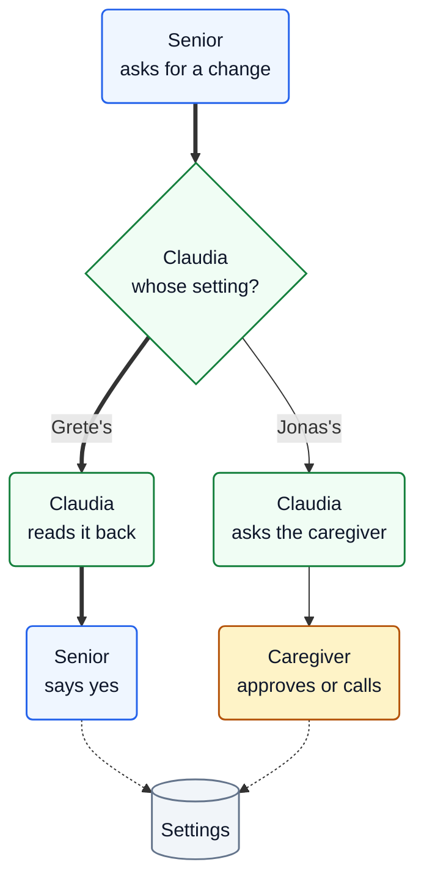
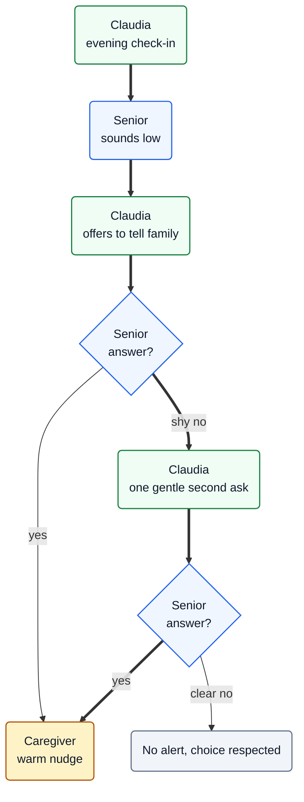
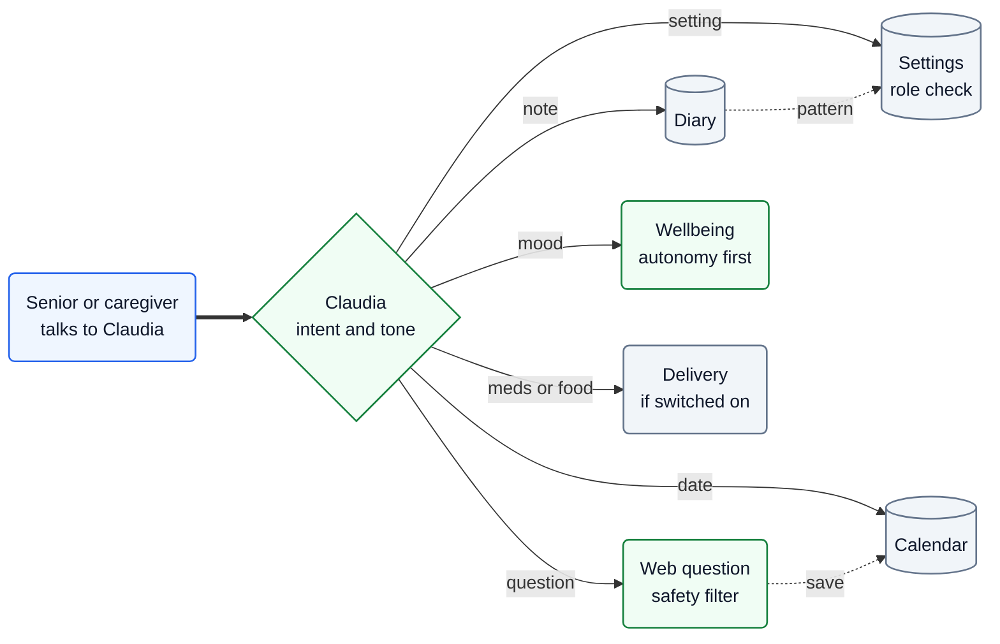

# Spec 4 — QA / Setup

> Feature notes: [`features/04-qa-setup.md`](../../features/04-qa-setup.md) · Shared requirements: [`README.md`](../README.md) · Design: [`design.html`](../../design.html) · Flows step by step: [`flows.html`](flows.html)

**Roles:** `G` = senior · `C` = caregiver (family, neighbour, volunteer or care service) · `A` = Claudia, the voice agent
**Priority:** `M` Must · `S` Should · `C` Could · **open** = not decided yet

## Contents

- [1. Basic information](#1-basic-information)
- [2. Requirements](#2-requirements)
  - [2.1 Functional: setup and pairing](#21-functional-setup-and-pairing)
  - [2.2 Functional: questions and actions](#22-functional-questions-and-actions)
  - [2.3 Functional: diary, settings and wellbeing](#23-functional-diary-settings-and-wellbeing)
  - [2.4 Config rights](#24-config-rights)
  - [2.5 Optional extensions](#25-optional-extensions)
  - [2.6 Agent tools](#26-agent-tools)
  - [2.7 Non-functional](#27-non-functional)
- [3. Flows](#3-flows)
  - [How to read the graphs](#how-to-read-the-graphs)
  - [3.1 Set up by talking](#31-set-up-by-talking)
  - [3.2 Ask anything](#32-ask-anything)
  - [3.3 Health question](#33-health-question)
  - [3.4 Diary](#34-diary)
  - [3.5 Change a setting](#35-change-a-setting)
  - [3.6 Feeling lonely](#36-feeling-lonely)
  - [Intent routing](#intent-routing)
- [4. Open points](#4-open-points)

## 1. Basic information

| | |
|---|---|
| Goal | One voice conversation does everything: set up the app without forms, answer everyday questions, keep a diary, change settings and notice when `G` is lonely. `G` keeps control of what `C` hears |
| Used by | `G` in the senior app · `C` in the caregiver app and web dashboard. Both talk to the same agent |
| Two modes | **Setup:** first launch, role and name, pairing code, sharing level, notification channel, extensions · **Daily use:** questions, diary, calendar, settings, wellbeing check-ins |
| Hands-free | After setup, the wake word "Hey Claudia" starts every conversation, as in [spec 3](../03-live-location/spec.md). Every change made by voice is read back before it counts |
| Builds on | Calendar ([spec 1](../01-calendar/spec.md)) · reminders ([spec 2](../02-pill-checker/spec.md)) · location sharing ([spec 3](../03-live-location/spec.md)) · ElevenLabs agent with the tools in 2.6 |
| Demo | Six flows, playable step by step in [`flows.html`](flows.html); PNGs in [`img/`](img/). People, times, places and answers in it are made up |

## 2. Requirements

### 2.1 Functional: setup and pairing

| ID | Requirement | Who | Prio | Status |
|---|---|---|---|---|
| SET-1 | Voice onboarding: on first launch `A` greets and asks whether this is the senior or a helper, and their name | A, G, C | M | flow 3.1 |
| SET-2 | `G`'s app makes a 6-character family code (e.g. `MD-7492`); `C` links by saying or typing it, no passwords | G, C | M | flow 3.1 |
| SET-3 | `C` says how they relate to `G` (daughter/son, neighbour, volunteer, care service) | C | M | flow 3.1 |
| SET-4 | `G` chooses what `C` may know: everything, a few things, or `G` decides each time. `A` explains in plain words what the lowest level means, also in an emergency | G | M | flow 3.1; `C` present if possible |
| SET-5 | `C` chooses how they are told: push, SMS, call, email or in-app; at once or as a daily summary; quiet hours; optional backup contact | C | M | flow 3.1 |
| SET-6 | Extensions (telemedicine, delivery) offered with yes / no / later | G | C | who approves **open** |
| SET-7 | `G`'s daily check-in times are set during setup | G | M | flow 3.6 uses 19:00 |
| SET-8 | The app logs what `G` agreed to and when; consent can be taken back at any time | A | M | defined |

### 2.2 Functional: questions and actions

| ID | Requirement | Who | Prio | Status |
|---|---|---|---|---|
| QA-1 | One entry point: everything starts by talking to `A`; `A` routes to diary, calendar, web question, setting, wellbeing or (if switched on) delivery | G, C | M | see [Intent routing](#intent-routing) |
| QA-2 | Everyday questions (opening hours, weather, buses) are answered in at most two short, calm sentences | A | M | flow 3.2 |
| QA-3 | A web answer can become a calendar entry ("Shall I put it in your calendar?") | A, G | M | flow 3.2 |
| QA-4 | Medical safety filter: no diagnosis, no dosage advice. `A` declines kindly and offers a doctor's appointment | A | M | flow 3.3 |
| QA-5 | With telemedicine switched on, `A` offers a certified doctor; `G` agrees each time before anything is handed over. Not an emergency channel | A, G | C | flow 3.3; provider **open** |
| QA-6 | Failed web search: `A` says so in one calm sentence, asks `G` to tell `C`, saves the question and tries again by itself | A | M | flow 3.2 |

### 2.3 Functional: diary, settings and wellbeing

| ID | Requirement | Who | Prio | Status |
|---|---|---|---|---|
| DIA-1 | Everything `G` says or asks is kept in `G`'s diary in the app | A | M | flows 3.2, 3.4 |
| DIA-2 | When something seems sensitive or useful for `C`, `A` asks `G` right away whether to share it. Yes: `C` gets a notification and a short summary, never the transcript. No or no answer: it stays private | A, G | M | flow 3.4 |
| DIA-3 | `G` can hear and delete diary entries and sees what was shared | G | M | flow 3.4 |
| CFG-1 | `G` changes comfort settings by voice; `A` reads each change back ("Reminder at 9:00, is that right?") | G | M | flow 3.5 |
| CFG-2 | A request from `G` for a setting that belongs to `C` becomes a pending approval for `C`; `G` is told | A, C | M | flow 3.5 |
| CFG-3 | `G` cannot switch off live location or the health monitor from `G`'s app | G | M | flow 3.5 |
| MH-1 | `A` notices `G`'s mood during normal conversation, without questionnaires | A | M | flow 3.6 |
| MH-2 | Loneliness, autonomy first: `A` offers to tell `C`; after a shy no, one gentle second ask; a clear no is respected with no alert | A, G | M | flow 3.6 |
| MH-3 | Severe distress: `C` is told according to the sharing level `G` chose at setup | A | M | lowest-level case **open** |

### 2.4 Config rights

| Who | Controls |
|---|---|
| `G` | Comfort settings: voice, speed, volume, language, reminder times, snooze duration; own sharing level and diary sharing |
| `C` | Medication doses, strike thresholds, emergency contacts, notification channel, live location, health monitor |
| Approval | If `G` asks for a setting `C` controls, it becomes a pending approval for `C` |

The final split of each setting still has to be confirmed by the team (see open points).

### 2.5 Optional extensions

| ID | Extension | What it does | Prio | Status |
|---|---|---|---|---|
| EXT-1 | Telemedicine | Hands `G` over to a certified telemedicine service on request; `G` agrees each time | C | flow 3.3 |
| EXT-2 | Delivery orders | Medicine needs go to Shop Apotheke, meals and groceries to Lieferando | C | not in the flows |

If an extension is off, `A` does not offer it. If `G` asks for it, `A` says it is not switched on and offers to tell `C`.

### 2.6 Agent tools

ElevenLabs agent tools behind the flows:

| Tool | Used in |
|---|---|
| `complete_voice_registration(role, name, relationship, pairing_code)` | 3.1 |
| `log_diary_entry(author_role, category, summary)` | 3.2, 3.4 |
| `add_calendar_event(title, datetime, reminder_minutes_before)` | 3.2 |
| `web_qa_search(query)` | 3.2, 3.3 |
| `update_system_config(role, setting_key, new_value, requires_caregiver_approval)` | 3.5 |
| `assess_emotional_wellbeing(mood_score, loneliness_detected, user_consented_to_notify, severity, notes)` | 3.6 |
| `start_telemedicine_handover(reason)` *(extension)* | 3.3 |
| `queue_delivery_order(item, provider)` *(extension)* | — |

### 2.7 Non-functional

Shared requirements (simplicity, voice first, legibility, platform, language, response time) are in [`README.md`](../README.md).

| ID | Area | Requirement | Status |
|---|---|---|---|
| QA-N1 | Privacy | Nothing sensitive reaches `C` without `G`'s consent, within `G`'s sharing level. Health data is a special category under GDPR | legal review **open** |
| QA-N2 | Medical safety | `A` never gives medical content itself | defined |
| QA-N3 | Calm and short | Answers in at most two short sentences; one offer at a time | defined |
| QA-N4 | Autonomy | `A` asks, never pushes; one follow-up at most; a clear no is final | defined |
| QA-N5 | No passwords | Pairing by family code and voice only | defined |
| QA-N6 | Voice identity | The app knows whether `G` or `C` is speaking | method **open** |

## 3. Flows

| # | Flow | Started by | Result |
|---|---|---|---|
| 1 | [Set up by talking](flows.html#1) | Claudia | `G` and `C` set up and linked, with no forms or passwords |
| 2 | [Ask anything](flows.html#2) | `G` | Short answer, turned into a calendar entry |
| 3 | [Health question](flows.html#3) | `G` | No medical advice; `G` talks to a certified doctor |
| 4 | [Diary](flows.html#4) | `G` | Note kept; `C` gets a short summary because `G` said yes |
| 5 | [Change a setting](flows.html#5) | `G` | Own setting changed at once; `C`'s setting waits for `C` |
| 6 | [Feeling lonely](flows.html#6) | Claudia | `G` agrees after one gentle ask; `C` gets a warm nudge |

### How to read the graphs

Vertex-edge graphs. Thick edges are the main path; thin edges are branches; dotted edges are side effects.

| Colour | Who |
|---|---|
| Blue | Senior (`G`) |
| Amber | Caregiver (`C`) |
| Green | Claudia |
| Grey | Stored information and outside services |

### 3.1 Set up by talking

| | |
|---|---|
| Started by | Claudia |
| Trigger | First launch of the app |
| Result | `G` and `C` set up and linked, with no forms or passwords |
| Step by step | [`flows.html#1`](flows.html#1) |
| Images | [`img/set-up-overview.png`](img/set-up-overview.png) and steps in [`img/`](img/) |

- Covers: SET-1 to SET-5, SET-8
- **Open:** extensions question in setup (not shown); who approves extensions; check-in times step (not shown)

### 3.2 Ask anything

| | |
|---|---|
| Started by | `G` |
| Trigger | "Hey Claudia, when does the pharmacy close today?" |
| Result | Short answer, turned into a calendar entry |
| Step by step | [`flows.html#2`](flows.html#2) |
| Images | [`img/ask-anything-overview.png`](img/ask-anything-overview.png) and steps in [`img/`](img/) |

- Covers: QA-1, QA-2, QA-3, QA-6, DIA-1
- **Open:** web sources and safety filtering; how often to retry after a failed search

### 3.3 Health question

| | |
|---|---|
| Started by | `G` |
| Trigger | "Hey Claudia, can I take two of my blood pressure tablets?" |
| Result | No medical advice; `G` talks to a certified doctor |
| Step by step | [`flows.html#3`](flows.html#3) |
| Images | [`img/health-question-overview.png`](img/health-question-overview.png) and steps in [`img/`](img/) |

- Covers: QA-4, QA-5, EXT-1
- **Open:** telemedicine provider and integration (mock for the demo if there is no API); whether `C` is told about the doctor call

### 3.4 Diary

| | |
|---|---|
| Started by | `G` |
| Trigger | "Hey Claudia, I slept badly again. My back hurts." |
| Result | Note kept; `C` gets a short summary because `G` said yes |
| Step by step | [`flows.html#4`](flows.html#4) |
| Images | [`img/diary-overview.png`](img/diary-overview.png) and steps in [`img/`](img/) |

- Covers: DIA-1, DIA-2, DIA-3
- **Open:** what counts as "sensitive or useful for `C`"; how long entries are kept

### 3.5 Change a setting

| | |
|---|---|
| Started by | `G` |
| Trigger | "Hey Claudia, eight is too early for my reminder." |
| Result | Own setting changed at once; `C`'s setting waits for `C` |
| Step by step | [`flows.html#5`](flows.html#5) |
| Images | [`img/change-a-setting-overview.png`](img/change-a-setting-overview.png) and steps in [`img/`](img/) |

- Covers: CFG-1, CFG-2, CFG-3
- **Open:** final split of settings (2.4); a diary pattern ("8 is too early" said several times) suggesting a change by itself

### 3.6 Feeling lonely

| | |
|---|---|
| Started by | Claudia |
| Trigger | Evening check-in at 19:00 |
| Result | `G` agrees after one gentle ask; `C` gets a warm nudge |
| Step by step | [`flows.html#6`](flows.html#6) |
| Images | [`img/feeling-lonely-overview.png`](img/feeling-lonely-overview.png) and steps in [`img/`](img/) |

- Covers: MH-1, MH-2, SET-7
- **Open:** severe distress at the lowest sharing level (MH-3); how a "shy no" is told apart from a clear no

### Intent routing

How `A` sorts what `G` or `C` says, after setup. Every flow above starts here.

## 4. Open points

- [ ] Which flow is shown live in the pitch
- [ ] Final per-setting split between `C` and `G` (table in 2.4)
- [ ] Who may switch extensions on or off after setup (`G` alone, or with `C`'s approval)
- [ ] Severe distress with `G` at the lowest sharing level: notify `C` or not (current rule: follow `G`'s level)
- [ ] Telemedicine provider and integration (certified video consultation; mock for the demo if there is no API)
- [ ] Voice identity: how the app knows whether `C` or `G` is speaking
- [ ] Ambiguous utterances that fit two outcomes
- [ ] Web QA sources and safety filtering
- [ ] Meaning of the whiteboard arrows diary/web → change config (shown as dotted side effects for now)
- [ ] Legal review of consent wording, logging and data handover (GDPR)
- [ ] Agent name: the teammate's draft called the agent "Lina"; this spec and the flows use "Claudia" like features 1 to 3
- [ ] Original lines in the teammate's draft were German; flows use English like features 1 to 3. Demo language is open in [`README.md`](../README.md)
- [ ] Time Memory Capsule from the teammate's draft: not included here; decide whether it belongs elsewhere
