# Feature Spec — Voice Agent for Seniors

> One place for requirements and user flows. Basis for the pitch deck.
> Sources: [`project.md`](../project.md), [`user-story-map.md`](../user-story-map.md), [`features/`](../features/), [`design.html`](../design.html).

**Roles:** `G` = senior · `C` = family caregiver · `A` = Claudia, the voice agent
**Priority:** `M` Must · `S` Should · `C` Could (MoSCoW from the story map)
**Status:** anything not decided on the boards is marked **open**. Nothing here is invented beyond the sources.

## 1. Product in one table

| | |
|---|---|
| Problem | Family caregivers carry long-term stress and constant worry; the senior lives alone and the caregiver is the only lifeline |
| Solution | Voice-first agent that helps `G` through the day and gives `C` visibility and relief |
| Demo scope | 4 core features (all `M`): Calendar, Pill Checker, Live Location + Emergency, QA / Setup |
| Surfaces | Senior app (voice + large buttons) · caregiver app · web dashboard |
| Business model | Monthly subscription · add-ons (automatic pill purchase, delivery fees) · delivery partnerships |

## 2. Functional requirements

### 2.1 Calendar / Scheduling

| ID | Requirement | Who | Prio | Status |
|---|---|---|---|---|
| CAL-1 | One internal calendar shared by `G` and the family | G, C | M | defined |
| CAL-2 | `G` and `C` can both create events (`G` by voice, `C` by voice or UI) | G, C | M | defined |
| CAL-3 | Sync with `C`'s personal calendar | C | M | provider **open** |
| CAL-4 | Scheduled action `Ask`: `A` asks `G` a predefined question and logs the answer in the diary | A, G | M | defined |
| CAL-5 | Scheduled action `Stock reminder`: initiates ordering | A | M | ordering path **open** |
| CAL-6 | Availability check of caregivers for an appointment | A, C | M | defined |
| CAL-7 | Shift the appointment or assign a responsible `C` | A, C | M | who decides the shift is **open** |
| CAL-8 | Reminders for `C` and `G`, configurable in the calendar | G, C | M | defined |
| CAL-9 | `G` asks for the next appointment and who brings them; `A` answers with exact date, time and the caregiver who accepted | G | M | pitch scenario 1 |
| CAL-10 | `A` proposes a reminder plan (3 days ahead and the day before) and `G` confirms by voice | A, G | M | pitch scenario 1 |
| CAL-11 | `C` asks about a past appointment; `A` reports who accompanied `G` and how it went | C | M | pitch scenario 2 |
| CAL-12 | Outcome is read from uploaded documents ("all fine, no action needed") | A | M | who uploads, and how, is **open** |
| CAL-13 | `A` proposes the follow-up appointment: assign now, or ask one month before | A, C | M | pitch scenario 2 |
| CAL-14 | `A` notifies `C` ahead of an unassigned appointment; the link opens the assignment in the companion app | A, C | M | pitch scenario 3 |
| CAL-15 | `A` checks all connected timetables and suggests the caregiver who is free | A | M | pitch scenario 3 |
| CAL-16 | On acceptance the appointment goes into `G`'s calendar and is synced to `C`'s private calendar | A | M | extends CAL-3 |
| CAL-17 | Calendar shows status by colour (past: done, rescheduled, missed; future: neutral), plus assignee icon and location | C | M | pitch scenario 6 |
| CAL-18 | Appointment detail: repetition, reminder settings, type, type-specific prompts, "document result" checkbox, documentation location (notification only / add to diary) | C | M | pitch scenario 6 |

### 2.2 Pill Checker

| ID | Requirement | Who | Prio | Status |
|---|---|---|---|---|
| PILL-1 | Setup from a picture of the prescription: picture → plan → config | C | M | defined |
| PILL-2 | Intake times are calendar events | A | M | defined |
| PILL-3 | `A` asks `G` at the scheduled time; `G` confirms by voice | A, G | M | defined |
| PILL-4 | Taken → documented in the diary | A | M | defined |
| PILL-5 | Not home → response + documented | A, G | M | detection **open** |
| PILL-6 | Forgot / no answer → raise attention → report to `C` (health status) | A, C | M | thresholds **open** |
| PILL-7 | Verification by camera or sensor instead of asking | G | M | method for demo **open** |
| PILL-8 | Quick help | G | M | content **open** |

### 2.3 Live Location + Emergency Alert

| ID | Requirement | Who | Prio | Status |
|---|---|---|---|---|
| LOC-1 | `C` sees `G`'s location | C | M | defined |
| LOC-2 | `G` asks where `C` is ("Where is my son?") | G | M | lower priority, consent **open** |
| LOC-3 | `G` asks `A` to request a call ("Ask him to call me") → push to `C` | G, C | M | defined |
| EMG-1 | Emergency alert by button | G | M | defined |
| EMG-2 | Emergency alert when `G` is not responding | A | M | defined |
| EMG-3 | Emergency alert from a smart watch | G | C | out of demo? **open** |
| EMG-4 | "Take action" after an alert | A, C | M | action **open** |
| MSG-1 | Messaging inside this cluster | G, C | M | scope **open** |

### 2.4 QA / Setup

| ID | Requirement | Who | Prio | Status |
|---|---|---|---|---|
| QA-1 | Single entry: talk to the agent | G, C | M | defined |
| QA-2 | Memory or note → documented in the diary | G, C | M | defined |
| QA-3 | Date or event → added to the calendar | G, C | M | defined |
| QA-4 | Question → researched on the web → voice answer | G, C | M | sources and filtering **open** |
| QA-5 | Preference or setting → config changed | G, C | M | rights of `G` vs `C` **open** |
| QA-6 | Setup / onboarding | C | M | flow not drawn, **open** |

### 2.5 Recurring agent tasks

| ID | Requirement | Who | Prio | Status |
|---|---|---|---|---|
| TASK-1 | `C` creates a recurring question for `G` by voice (e.g. daily "How do you feel?") | C | M | pitch scenario 4 |
| TASK-2 | Answers are documented in a named diary section (e.g. "Daily Mood") | A | M | pitch scenario 4 |
| TASK-3 | `A` suggests a time that fits the day (9:00, after the tablet check) | A, C | M | pitch scenario 4 |
| TASK-4 | `C` sets up a weekly grocery task: `A` interviews `G` about what is needed | C, G | M | pitch scenario 5 |
| TASK-5 | Order is capped at a budget set by `C` (50 euro) | A | M | behaviour over budget **open** |
| TASK-6 | `A` places the order with a delivery partner (Flink named as example) | A | M | partnership and payment **open** |
| TASK-7 | Delivery date and a reminder are added to `G`'s calendar | A | M | pitch scenario 5 |

### 2.6 Across all features

| ID | Requirement | Prio | Status |
|---|---|---|---|
| X-1 | Web app + UI | M | defined |
| X-2 | Multilingual | M | languages **open** |
| X-3 | Caregiver dashboard: steer the agent, see status confirmations | M | defined |
| X-4 | Reminders with confirmation | M | defined |

### 2.7 After the demo

| Prio | Features |
|---|---|
| S | Daily check · message to anyone · delivery |
| C | Time capsule + questioning · ringtones · smart watch · custom voice (**open**: `C` or `S`) · camera identifies objects · smart home · pill box with sensors |

## 3. Non-functional requirements

| ID | Area | Requirement | Source | Status |
|---|---|---|---|---|
| NFR-1 | Simplicity | Usable by non-technical people; technical concepts are abstracted into everyday words | design brief | defined |
| NFR-2 | Voice first | Every function reachable by voice; buttons only for core information and core actions such as emergency | design brief | defined |
| NFR-3 | Legibility | Senior app: large type (nothing to read below 22px), high contrast, large buttons in fixed positions | `design.html` | defined |
| NFR-4 | Platform | Cross-platform app on any phone; web dashboard for `C`; Siri integration | `project.md` | Siri scope **open** |
| NFR-5 | Language | Multilingual | story map | languages **open** |
| NFR-6 | Privacy | Location, diary and health data are personal; sharing needs consent | feature 3 | model **open** |
| NFR-7 | Permissions | Clear rule which settings `G` may change by voice and which only `C` | feature 4 | **open** |
| NFR-8 | Emergency reliability | An alert must reach `C` | feature 3 | target and fallback **open** |
| NFR-9 | Voice response time | Conversation feels live | — | target **open** |
| NFR-10 | Answer safety | Web answers come from safe sources | feature 4 | filtering **open** |
| NFR-11 | Cost | Voice agent and cloud storage costs are covered by the subscription | `project.md` | price **open** |
| NFR-12 | Demo | Mockups and lightweight PoCs; voice via ElevenLabs; no tests | `AGENTS.md` | defined |

## 4. User flows (feature level)

Vertex-edge graphs. Thick edges are the path to show in the pitch; thin edges are branches; dotted edges are side effects.

| Colour | Who |
|---|---|
| Blue | Senior (`G`) |
| Amber | Caregiver (`C`) |
| Green | Claudia |
| Grey | Stored information and outside services |

### Flow 1 — Appointment finds a responsible caregiver

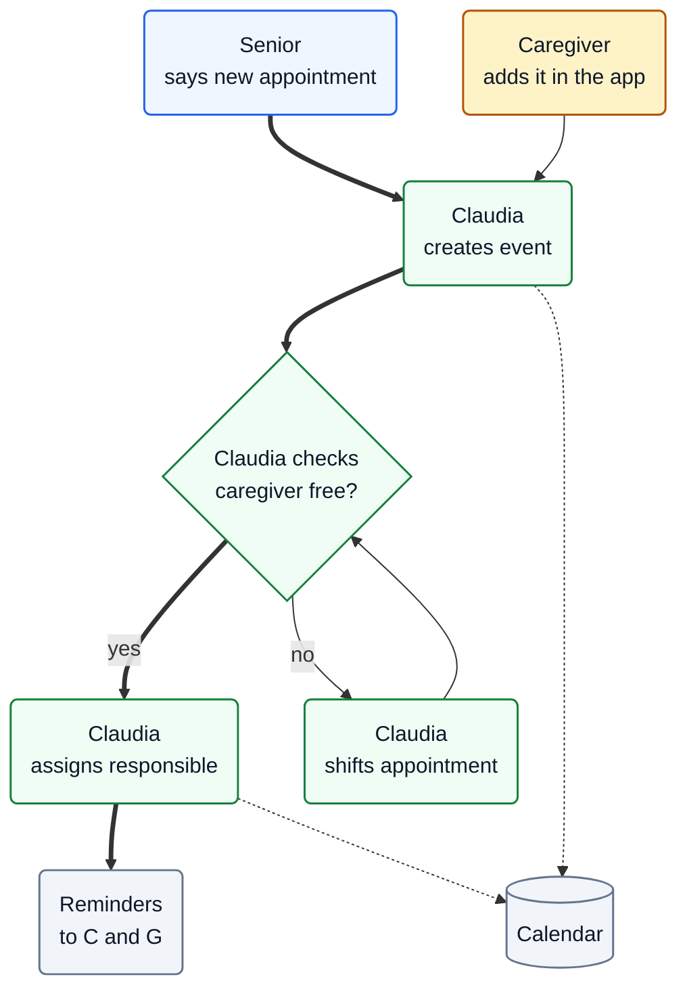

- Covers: CAL-1, CAL-2, CAL-6, CAL-7, CAL-8
- **Open:** who confirms a shift; which external calendar is synced

### Flow 2 — Tablets: from prescription photo to daily check

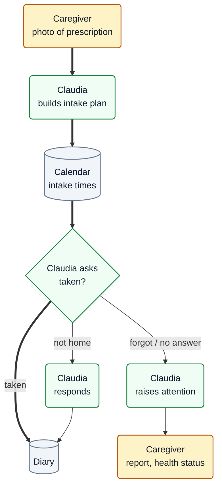

- Covers: PILL-1 to PILL-6
- **Open:** camera vs. "just ask"; number of retries before `C` is told; how "not home" is detected

### Flow 3 — "Where is my son?"

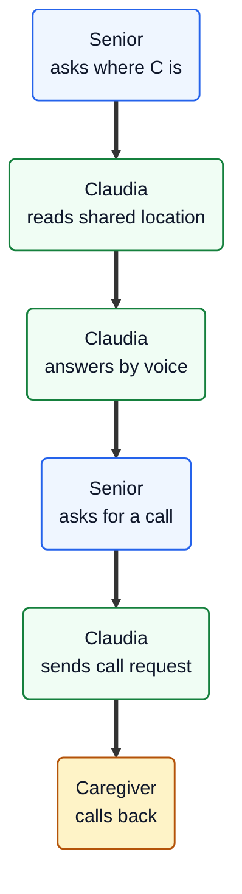

- Covers: LOC-2, LOC-3
- **Open:** how exact the answer is (place name vs. "at work"); consent of `C`

### Flow 4 — Emergency alert

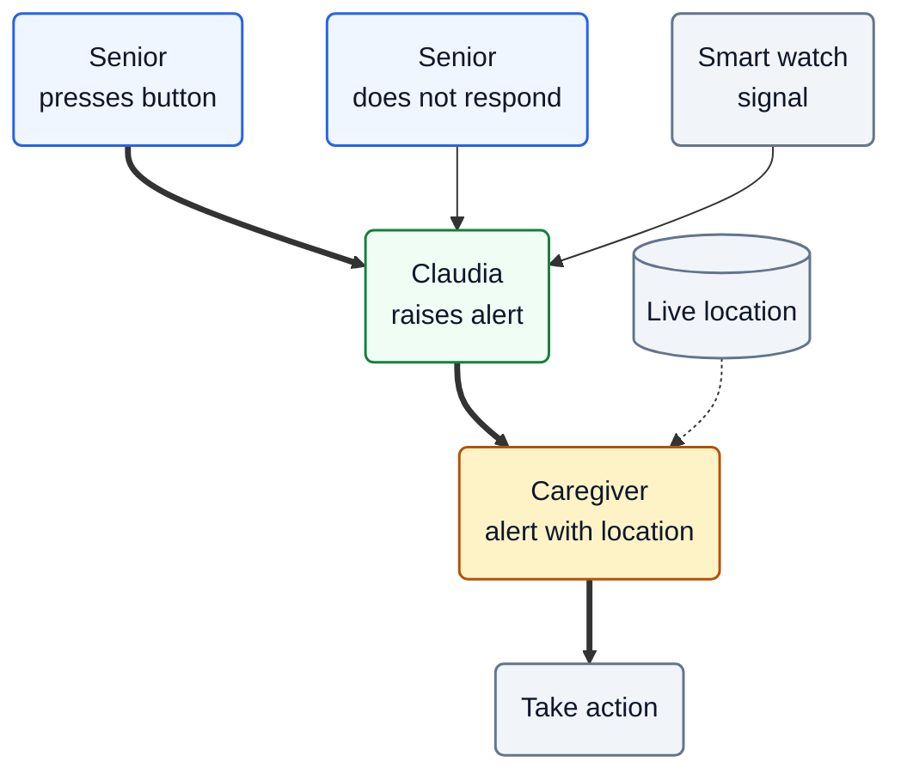

- Covers: LOC-1, EMG-1 to EMG-4
- **Open:** what "take action" is (call `C`, emergency services, escalation chain); smart watch in the demo or not

### Flow 5 — Talk to the agent

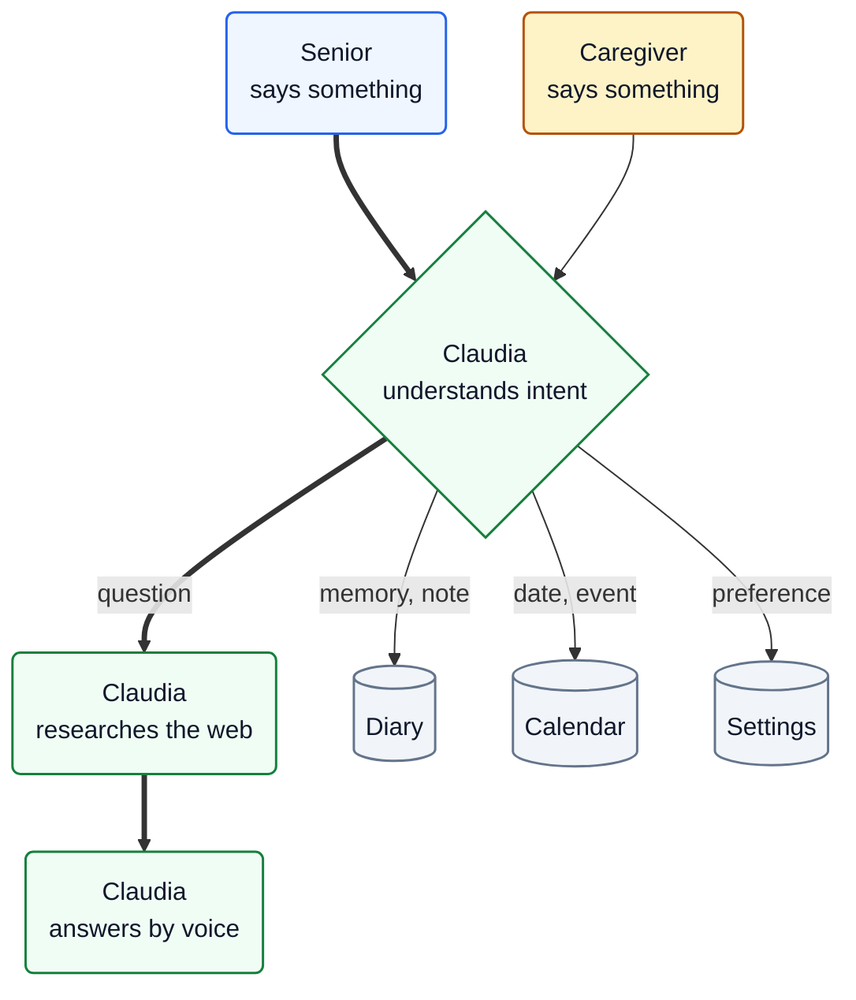

- Covers: QA-1 to QA-5
- **Open:** which settings `G` may change; web sources; the onboarding flow (QA-6)

## 5. Pitch scenarios

Six scenarios to show in the pitch. Dialogue lines are the script; names in brackets are placeholders.

| # | Scenario | Who | Caregiver pain it answers | Screen in `design.html` |
|---|---|---|---|---|
| 1 | "When is my next dentist appointment?" | G | Senior alone, caregiver the only lifeline | Voice mode, senior home |
| 2 | "Dad had a dentist appointment today" | C | Constant worry, no feedback | Voice mode (caregiver app) |
| 3 | Claudia asks who takes the next appointment | C | Load stays with one person | Calendar question "Who takes Grete?" |
| 4 | Daily mood question | C | No feedback on how the senior is doing | Diary card; setup screen **missing** |
| 5 | Weekly groceries | C | Care is time-intensive | **missing** |
| 6 | Calendar history and appointment detail | C | Constant worry, no overview | Week view exists; history colours and detail menu **missing** |

### Scenario 1 — G asks for the next appointment

| Speaker | Line |
|---|---|
| G | "Hey Claudia, when is my next dentist appointment and who could bring me?" |
| Claudia | "Let me check." |
| Claudia | Gives the exact date and time. "Your son [name] already accepted and will bring you." (PNGs use Wednesday, 2 December, 10:30 and "Jonas" as examples) |
| Claudia | "I'll remind you three days in advance and the day before. Is that okay?" |
| G | Confirms. |

**For humans (PNG)**

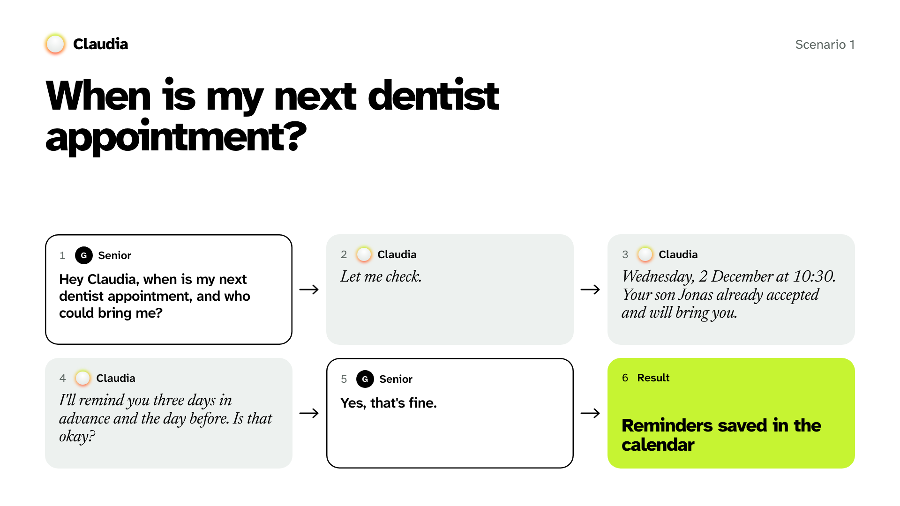

Phone screens per step: [`flows/01-next-appointment/`](flows/01-next-appointment/)

**For agents (Mermaid)**

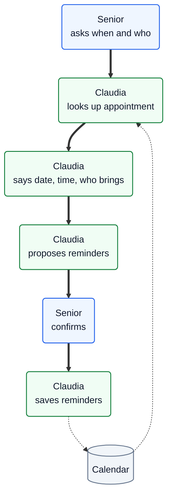

- Covers: CAL-8, CAL-9, CAL-10
- **Open:** what `A` says when nobody has accepted yet

### Scenario 2 — C checks on today's appointment

| Speaker | Line |
|---|---|
| C | "Hey Claudia, my dad had a dentist appointment today. Could you check?" |
| Claudia | "Yes, found it. Your brother [name] brought him." |
| Claudia | "According to the uploaded documents the check went well. Everything is fine, no action needed." |
| Claudia | "The next check-up is in one year. Do you want me to assign it now, or ask one month before?" |

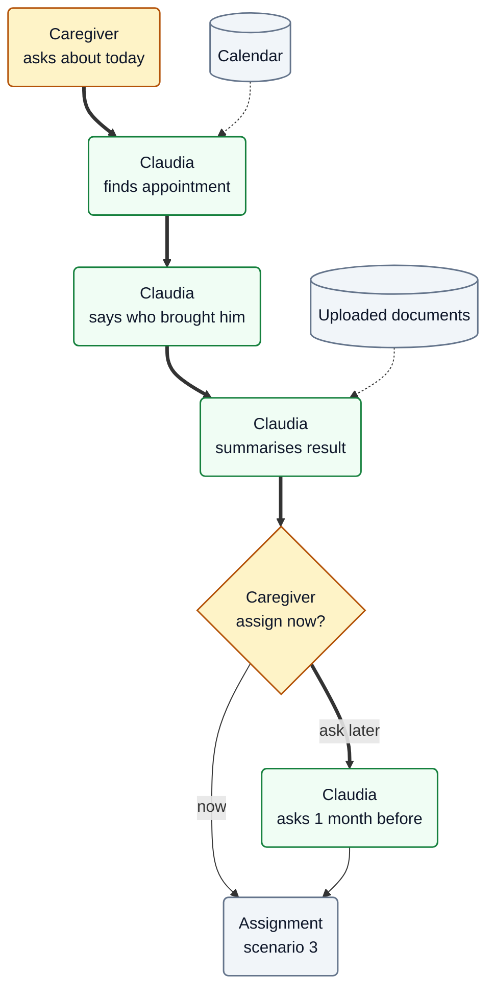

- Covers: CAL-11, CAL-12, CAL-13
- **Open:** who uploads the documents and in which form; how far `A` may interpret a medical result

### Scenario 3 — Claudia finds the responsible caregiver

| Speaker | Line |
|---|---|
| Claudia (notification) | "Hey, dentist appointment in one month. Click here to assign the task." |
| Claudia (companion app) | "I checked all the connected timetables. It seems you'll have time while the others will be busy. Will you take the responsibility?" |
| C | "Yes, can do that." |
| Claudia | "Great, I'll add this to [G]'s calendar and sync it with your private calendar too." |

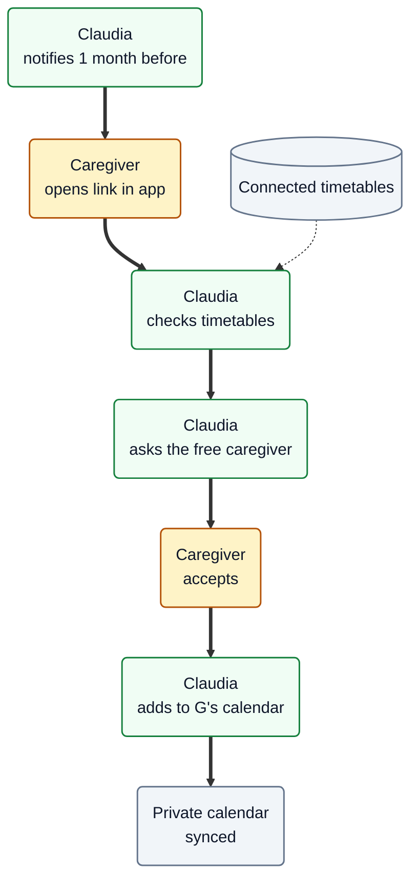

- Covers: CAL-6, CAL-7, CAL-14, CAL-15, CAL-16
- **Open:** what happens when `C` declines or nobody is free; which calendars can be connected

### Scenario 4 — Daily mood question

| Speaker | Line |
|---|---|
| C | "Hey Claudia, could you add a daily task that asks how my grandfather feels and add it to the diary?" |
| Claudia | "Of course. I will add it to the diary under 'Daily Mood' and document it daily." |
| Claudia | "At which time do you want me to ask your granddad? I suggest 9 am, after I asked if he took all the pills." |

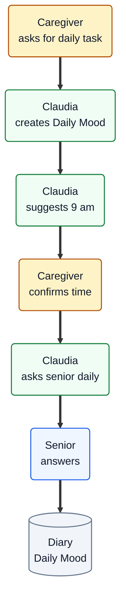

- Covers: CAL-4, TASK-1, TASK-2, TASK-3
- **Open:** whether `C` is told when the mood changes (change detection is listed in `project.md`)

### Scenario 5 — Weekly groceries

| Speaker | Line |
|---|---|
| C | "Hey Claudia, I want you to ask my [G] on a weekly basis if he needs groceries. Interview him on his needs and make sure the order is limited to 50 euro. Once you've got everything, order at Flink and add the delivery date and a reminder to his calendar." |

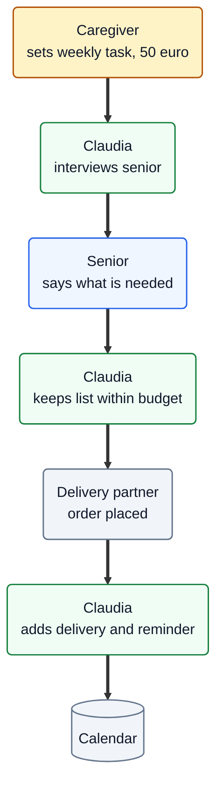

- Covers: CAL-5, TASK-4 to TASK-7; ties to the delivery add-on in the business model
- **Open:** what `A` does when the list exceeds 50 euro; payment; whether `C` approves each order; Flink is the named example, no partnership exists yet

### Scenario 6 — Calendar history and appointment detail

| Where | Colour | Meaning | How often |
|---|---|---|---|
| Past | Green | Took place | Most |
| Past | Yellow | Rescheduled | Rare |
| Past | Red | Missed | Very rare |
| Future | Neutral | Planned | All |

- Every appointment shows an icon of who is assigned and its location.
- In `design.html` these map to the existing status scale: lime, amber, coral.

| Detail menu item | Control |
|---|---|
| Repetition | Setting |
| Reminder settings | Setting |
| Type | Setting |
| Prompts / questions for this type | List |
| Document result | Checkbox |
| Documentation location | Dropdown: notification only · add to diary |

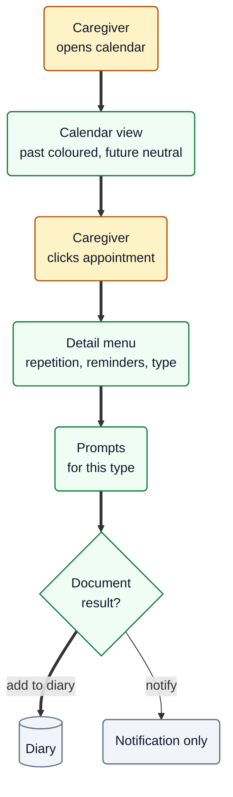

- Covers: CAL-17, CAL-18
- **Open:** list of appointment types and their prompts; whether `G` sees any of this

## 6. Open points to settle before the deck

- [ ] Order of the six scenarios and which one is shown live
- [ ] Screens missing in `design.html`: recurring task setup, groceries, calendar history colours, appointment detail menu, notification
- [ ] Uploaded documents: who uploads, format, how far `A` may interpret results
- [ ] Declined or unfilled assignment: what `A` does next
- [ ] Grocery order: over budget, payment, approval by `C`, delivery partner
- [ ] Appointment types and their prompts
- [ ] Demo verification for tablets: camera or "just ask"
- [ ] What happens after an emergency alert
- [ ] Escalation thresholds (retries, delay before `C` is told)
- [ ] Consent and precision for "G sees C"
- [ ] Which settings `G` may change by voice
- [ ] Onboarding / setup flow
- [ ] Languages for the demo
- [ ] External calendar provider
- [ ] Subscription price
- [ ] Direct mental-health feature for `C` (check-in, stress score, helpline) — listed as open in `project.md`
