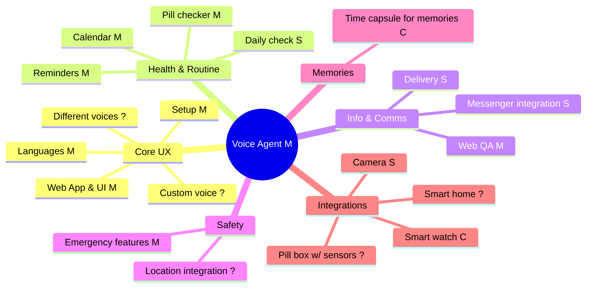

# User Story Map — Voice Agent for Seniors

> Source: whiteboard photos IMG_2833, IMG_2840, IMG_2841 (not in repo).
> Main idea (board): *"To help regulate mental health of old people (Voice Agent)"*.

**Legend:** `M` Must · `S` Should · `C` Could · `W` Won't · `?` = open / to be discussed
**Roles:** `G` = senior (grandparent) · `C` = caregiver (family)

## 1. Mindmap (unsorted brainstorm)

## 2. Prioritization (MoSCoW)

```mermaid
flowchart LR
    subgraph M["MUST — Primary"]
      direction TB
      m1[Reminders]
      m2[Web App + UI]
      m3[Pill Checker]
      m4[Calendar]
      m6[Emergency Alert]
      m7[Web QA]
      m8[Setup]
      m9[Live Location]
      m10[Multilingual]
    end
    subgraph S["SHOULD — Secondary"]
      direction TB
      s1[Daily Check]
      s2[Message to anyone]
      s3[Delivery]
    end
    subgraph C["COULD — Tertiary"]
      direction TB
      c1["Time Capsule + Questioning ★"]
      c2[Ringtones]
      c3[Smart Watch]
      c4["Custom Voice ?"]
      c5["Camera — identify objects ★"]
      c6[Smart Home]
      c7["Pill Box ★"]
    end
    M --> S --> C

    classDef must fill:#e8590c,stroke:#e8590c,color:#fff
    classDef should fill:#1e3a5f,stroke:#1e3a5f,color:#fff
    classDef could fill:#f1f3f5,stroke:#868e96,color:#212529
    class m1,m2,m3,m4,m6,m7,m8,m9,m10 must
    class s1,s2,s3 should
    class c1,c2,c3,c4,c5,c6,c7 could
```

- ★ = red star on board; meaning **open** (assumed: highlight / favourite)
- Primary list numbering skips `5` — **open**
- `W` (Won't) column: empty on board

## 3. Feature clusters for the demo

Board groups the Musts into **4 core features** (✔ = marked on board):

| # | Core feature | Includes | Spec |
|---|---|---|---|
| 1 | Scheduling ✔ | Calendar, Reminders | [01-calendar](features/01-calendar.md) |
| 2 | Pill Checker ✔ | Pill checker, Reminders | [02-pill-checker](features/02-pill-checker.md) |
| 3 | Live Location + Emergency Alert + Messaging | Live location, Emergency, Messaging | [03-live-location](features/03-live-location.md) |
| 4 | Web QA / Setup | Web QA, Setup, Config | [04-qa-setup](features/04-qa-setup.md) |

Second cluster `3` on board: **Delivery · Custom Voice · Ringtone** — scope **open**.

## Open points

- [ ] Meaning of red ★ marks
- [ ] Missing item #5 in Primary list
- [ ] Custom voice: `C` or `S`? (board: "Custom Voice 2?")
- [ ] Location integration / Pill box / Smart home priority on mindmap unreadable
- [ ] Erased green bubble on mindmap (marked `C`) — content unknown
